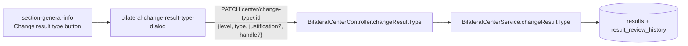

# Design — Bilateral "Change result type": optional justification

## Document Control

| Field | Value |
|---|---|
| Spec | `bilateral/change-type-optional-justification` |
| Status | approved (2026-10-26) |
| Depth | **Lite** |
| Requirements | `./requirements.md` (approved 2026-10-26) |
| Verified at | `897b85c2b` |

## 1. Executive Summary

Two small edits, one per package. **Client:** drop the reason from the dialog's enable rule and remove its `*`. **Server:** declare the field optional and append the reason to the review-history comment only when it has text. No migration, no new endpoint, no read-payload change.

## 2. Architecture Overview



## 3. Directory Structure (touched files only)

```text
onecgiar-pr-client/src/app/pages/bilateral/components/bilateral-change-result-type-dialog/
├── bilateral-change-result-type-dialog.component.html     # remove * on the reason label
├── bilateral-change-result-type-dialog.component.ts       # canSubmit() no longer reads justification
└── bilateral-change-result-type-dialog.component.spec.ts  # NEW — no spec exists today
onecgiar-pr-server/src/api/bilateral/
├── dto/change-center-result-type.dto.ts                   # justification → optional
└── services/
    ├── bilateral-center.service.ts                        # conditional reason suffix
    └── bilateral-center.service.spec.ts                   # comment assertions
onecgiar-pr-server/docs/bilateral-result-summaries.en.md   # change-log row
```

## 4. Data Model

No change. `result_review_history.comment` keeps its column; only the written text changes when no reason is given.

## 5. API Design

`PATCH /api/bilateral/center/change-type/:resultId` — same route, same response.

| Field | Before (declared) | After |
|---|---|---|
| `result_level_id` | required | required |
| `result_type_id` | required | required |
| `justification` | required string | **optional** string; absent, `""`, or blank all mean "no reason" |
| `handle` | required for Knowledge Product | unchanged |

Backward compatible: every body accepted before is accepted after.

## 6. Backend Module Design

- **DTO:** `justification` becomes optional (`@ApiPropertyOptional`, `@IsOptional`, keeps `@IsString`; drops `@IsNotEmpty`; property typed optional). Swagger now shows it as optional (BIL-CTJ-R-3).
- **Service:** the comment base stays `Result type changed from level X, type Y to level A, type B.`; ` <trimmed reason>` is appended only when the trimmed reason is non-empty (BIL-CTJ-R-2). All other steps of `changeResultType` are untouched (NFR-1).

## 7. Frontend Component Design

- **Enable rule:** `canSubmit()` = a new type is selected AND (not Knowledge Product OR handle has text) AND not submitting. The reason is no longer part of it (BIL-CTJ-R-1).
- **Label:** "Why is this change needed?" keeps its wording and textarea; only the `<span aria-hidden="true">*</span>` is removed. The placeholder becomes `Optional — explain the correction for the review history.` so the optional state is readable without a marker.
- **Request body:** unchanged shape — `justification: this.justification.trim()` (may be `""`). Retention of a typed reason (two-way binding, reset on close) is unchanged.
- **States:** loading (`Changing…`), error (`bctd-error`), success (close + `changed` emit) all unchanged.

## 8. Shared Contracts

`onecgiar-pr-server/docs/bilateral-result-summaries.en.md` gets one change-log row: `justification` on `center/change-type` is optional; when absent the review comment carries no reason. No read-payload shape changes.

## 9. Design Decisions

| ID | Decision | Rejected alternative | Why |
|---|---|---|---|
| DD-1 | Client keeps sending `justification` (possibly `""`) | Omit the key when empty | Fewer branches; server treats both the same |
| DD-2 | Server owns the "no reason" text (conditional suffix) | Client sends a default reason like "Not provided" | Keeps history honest; fixes the `undefined` risk for any caller (Swagger, scripts) |
| DD-3 | Make the DTO optional even though no pipe enforces it today | Leave the DTO as-is | The DTO is the published contract (Swagger); leaving `@IsNotEmpty` would mislead and would break the day a pipe is added |
| DD-4 | Placeholder says "Optional" instead of adding "(optional)" to the label | Change the label text | Ticket asks to keep the field and remove only the marker; label text stays recognisable |

### Reversion challenge (Step 2.3) — DD-1/DD-2 remove a required-field guard

**Q: What does removing this break?**
- Review history may hold no reason → accepted product decision (feedback item 20).
- The comment would print `undefined` / a trailing space → **addressed** by DD-2.
- A reader that parses the reason out of the comment → none: `grep -rn "Result type changed from" onecgiar-pr-server/src onecgiar-pr-client/src` → 1 hit, the writer itself (`bilateral-center.service.ts:799`).
- Existing tests asserting the button is disabled without a reason → none: the dialog has no spec file (see P-4).

Outcome: no unaddressed breakage.

## 10. Budget (Step 2.4)

| Metric | Expected |
|---|---|
| Tasks | 2 (client, server) |
| LOC | ~120 (≈15 production, ≈100 tests incl. the new dialog spec, 1 doc row) |
| Review rounds | 2 (1 per task) |

Matches Lite.

## 11. Premise Ledger

Count: 6 verified · 0 `UNVERIFIED`.
Blast-radius triggers: `live-path` (names a user action) · `consumer` (changes a DTO field's required-ness and a stored comment text). `shared-state`: does not fire — the dialog state is local to one component.

| # | Claim | Class | Citation (as run) | Verified at | If false | Settled by |
|---|---|---|---|---|---|---|
| P-1 | The button's enable rule requires a non-blank reason | location | `bilateral-change-result-type-dialog.component.ts:67-70` (`!!this.justification.trim()`) | `897b85c2b` | High — T-1 targets the wrong code | — |
| P-2 | The "Change result type" button in bilateral General Information opens this dialog | live-path | `section-general-info.component.html:18-21` (`canChangeResultType()` → `openChangeResultType()`) → `:165` `<app-bilateral-change-result-type-dialog>` → dialog `submit()` → `PATCH_changeBilateralResultType` (`bilateral-api.service.ts:62`) → controller `@Patch('change-type/:resultId')` (`bilateral-center.controller.ts:79`) → `changeResultType` (`bilateral-center.service.ts:718`) | `897b85c2b` | High — fix lands on code the user never reaches | — |
| P-3 | The server does not reject an empty reason today (no pipe on the route, no global pipe) | existence | `bilateral-center.controller.ts:85-89` (plain `@Body()`); `grep -rn "useGlobalPipes\|APP_PIPE" onecgiar-pr-server/src` → 0 non-spec hits | `897b85c2b` | Low — T-2 would also need a pipe change | — |
| P-4 | No test file pins the dialog's required reason | consumer | `grep -rln "bctd\|change-result-type-dialog\|Change result type" onecgiar-pr-client/src onecgiar-pr-client/cypress \| grep -E "spec\|cy"` → 2 hits, both W1/W2 `result-header` / `rd-general-information` (different component); `section-general-info.component.spec.ts` has 0 hits for `ChangeResultType\|justification` | `897b85c2b` | Low — T-1 updates those tests | — |
| P-5 | The review-history comment text is read by no code | consumer | `grep -rn "Result type changed from" onecgiar-pr-server/src onecgiar-pr-client/src` → 1 hit (the writer, `bilateral-center.service.ts:799`) | `897b85c2b` | Low — T-2 must keep the prefix stable | — |
| P-6 | `ChangeCenterResultTypeDto` is used only by this route | consumer | `grep -rn "ChangeCenterResultTypeDto" onecgiar-pr-server/src` → controller `:20,:88`, service `:68,:721`, plus its own file | `897b85c2b` | Low — another caller would need review | — |
