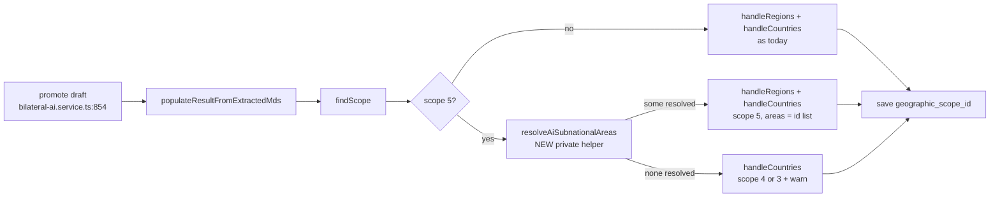

# Module Spec — `design.md`

## 1. Document Control

| Field | Value |
|---|---|
| Spec Path | `bugfix/ai-draft-subnational-geo` |
| Type / Depth | Bug · Lite |
| Ticket | INC-168504 |
| Requirements | [`requirements.md`](./requirements.md) |
| Verified at | `385d46e44` |
| Backend route | `nestjs-expert` (+ `tdd` recommended) — `software-architect/references/backend-routing.md` not consulted: Lite bugfix, no new module |

## 2. Executive Summary

Normalize the AI `geo_focus` **inside `populateResultFromExtractedMds` only**, before any write: collect the subnational codes, resolve them in one CLARISA query, then call the **unchanged** `handleRegions` / `handleCountries` with either scope 5 + `[{id}]` areas, or a country-level scope when nothing resolves.

## 3. Architecture Overview

## 4. Extended Directory Structure

| File | Change |
|---|---|
| `onecgiar-pr-server/src/api/bilateral/bilateral.service.ts` | Geo block of `populateResultFromExtractedMds` (`:5641-5668`) + one new private helper next to it |
| `onecgiar-pr-server/src/api/bilateral/bilateral.service.spec.ts` | New `describe('populateResultFromExtractedMds — Sub-national geo')` |

## 5. Data Model

No schema change. Reads `clarisa_subnational_scopes` (`id`, `code`, `country_iso_alpha_2`, `is_active`).

## 6. API Design

No endpoint or payload change. `/api/bilateral/*` untouched.

## 7. Backend Module Design

**Helper `resolveAiSubnationalAreas(geoFocus)` — returns `{ areas: {id}[], unresolved: string[] }`, writes nothing.**

| Step | Behavior | Req |
|---|---|---|
| 1. Collect | Entries from every `countries[i].subnational_areas` plus root `geoFocus.subnational_areas`, if any. Strings are codes; objects with `id` / `name` are passed through as-is (already the shape `lookupSubnationalAreas` accepts); objects with `code` are treated as codes. De-duplicate. | FR-1 |
| 2. Allowed countries | Set of `iso_alpha_2` of the draft's countries. Empty set → no country filter (draft identified countries by id/name). | FR-4 |
| 3. Resolve | One `find` on `_clarisaSubnationalAreasRepository` with `code IN (codes)` and `is_active = true`. | FR-1, NFR perf |
| 4. Filter | Keep a found row when the allowed set is empty or its `country_iso_alpha_2` is in it; when `country_iso_alpha_2` is null, use the code prefix before `-`. Others → unresolved. | FR-4 |
| 5. Return | `areas` = kept rows as `{ id }` + passed-through objects; `unresolved` = codes not kept. | FR-3 |

**Geo block in `populateResultFromExtractedMds`, for scope 5 only:**

| Case | Calls | Saved `geographic_scope_id` | Log |
|---|---|---|---|
| `areas` non-empty | `handleRegions(result, scope, regions)`; `handleCountries(result, countries, areas, 5, user)` | `resolveScopeId(5, countries)` = 5 | one `warn` if `unresolved` non-empty (FR-3) |
| `areas` empty, countries present | `handleRegions` with the original scope (clears regions as today, `regionsAreCleared`); `handleCountries(result, countries, [], fallback, user)` with `fallback = countries.length > 1 ? 3 : 4` (`handleSubnationals` returns early for ≠ 5) | `resolveScopeId(fallback, countries)` → 3 or 4 | one `warn` naming `unresolved` + result id (FR-2) |
| no countries | Unchanged path (today's behavior) | as today | — |

- Resolution (helper) runs **before** `handleRegions` / `handleCountries`, so a resolution failure writes nothing (FR-5).
- The existing `try/catch` stays around the whole block (FR-5 AND IT MUST).
- Scopes ≠ 5 skip the helper entirely: byte-identical calls to today (FR-6).
- **Known double read:** `lookupSubnationalAreas` re-reads the resolved `{id}`s. Accepted to keep the shared lookup untouched (FR-6); one small indexed query.

## 8. Frontend / UX Component Architecture

n/a — backend only.

## 9. Shared Contracts or Package Extensions

None.

## 10. Design Decisions

| ID | Decision | Rejected | Why |
|---|---|---|---|
| DD-1 | Translate codes → `{id}` in a private helper on the AI path | Add `code` to `lookupSubnationalAreas` | Proposal scope; the shared lookup also serves the API and the resubmission preflight |
| DD-2 | Fallback keeps countries at scope 4/3 | Leave scope null / throw | ADS-FR-2: a scope always lands |
| DD-3 | Country filter by `country_iso_alpha_2`, code prefix as backup | Trust any resolved code | ADS-FR-4; the all-to-all writer would spread a stray code to every country |
| DD-4 | Fallback passes regions with the **original** scope object | Re-fetch scope 4 | `regionsAreCleared` already clears for scope 5 with no regions; avoids an extra query |

Reversion challenge (Step 2.3): no DD removes delivered behavior — n/a.

### Budget (tripwire)

| Expected tasks | Expected LOC | Expected review rounds |
|---|---|---|
| 2 | ~60 prod + ~140 test | 1–2 |

Matches Lite.

## 11. Premise Ledger

Count: 8 rows — 6 verified, 2 `UNVERIFIED` (1 High, 1 Low).
Blast-radius triggers: `live-path` (names the promote action) fired; `shared-state` and `consumer` — none apply: no shared handler, exported symbol, or stored field changes; the helper is private and new.

| # | Claim | Class | Citation (as run) | Verified at | If false | Settled by |
|---|---|---|---|---|---|---|
| P-1 | Promote reaches the geo block: `bilateral-ai.service.ts:854` → `populateResultFromExtractedMds` (`bilateral.service.ts:5605`) → `:5641` geo block → `handleCountries :6605` → `handleSubnationals :6733` (scope 5 branch, `:6740`) → `lookupSubnationalAreas :6786` | live-path | `grep -rn "populateResultFromExtractedMds" src --include=*.ts` (server, non-spec) → 1 caller `bilateral-ai.service.ts:854` | `385d46e44` | Fix lands off the user path — High | — |
| P-2 | `lookupSubnationalAreas` accepts only `{id}` / `{name}` and throws 400 on an empty list | existence | `bilateral.service.ts:6787-6803` | `385d46e44` | DD-1 unnecessary — Low | — |
| P-3 | `handleCountries` writes countries before calling `handleSubnationals` | existence | `bilateral.service.ts:6623-6643` | `385d46e44` | FR-5 ordering moot — Low | — |
| P-4 | `handleSubnationals` returns early for scope ≠ 5 | existence | `bilateral.service.ts:6740` (`if (geoScopeId !== 5) return;`) | `385d46e44` | Fallback (DD-2) would still throw — High | — |
| P-5 | `resolveScopeId(4\|3, countries)` yields 4 for one country, 3 for several | existence | `bilateral.service.ts:6600-6603` | `385d46e44` | Fallback scope wrong — Low | — |
| P-6 | `clarisa_subnational_scopes` has `code` (unique), `country_iso_alpha_2`, `is_active` | data-env | `clarisa-subnational-scope.entity.ts:5-60`; `is_active` used at `clarisa-subnational-scope.service.ts:58` | `385d46e44` | Helper query shape changes — Low | — |
| P-7 | AI codes (`CO-CUN`) match `clarisa_subnational_scopes.code` byte-for-byte | data-env | `UNVERIFIED — confirm at source before relying on it` (indirect: client maps AI codes to names via the CLARISA list by `iso_alpha_2`, `draft-result-card.component.ts:37-49`) | — | Every promotion takes the fallback; fix degrades to scope 4 — High | T1 first step: sample query on QA DB (`SELECT code FROM clarisa_subnational_scopes WHERE country_iso_alpha_2='CO' LIMIT 5`) vs. 3 stored `extracted_mds` — owner: implementer + user (DB access) |
| P-8 | 81 / 192 PROD drafts are Sub-national | data-env | `UNVERIFIED — confirm at source before relying on it` | — | Priority only — Low | user-stated; user |
