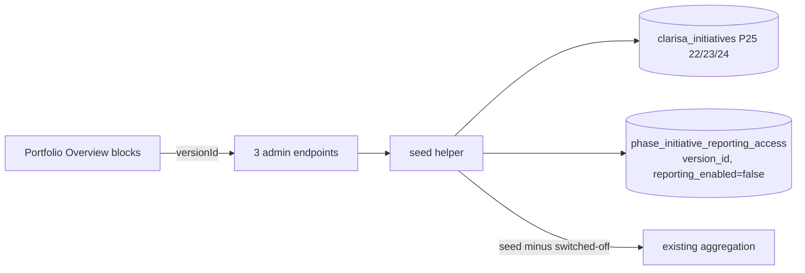

# Design — INC-168459 Portfolio Overview feedback (`POD`)

**Answer first:** Three small changes on existing code, with no migration and no new endpoint:
- **Server (POD-R-2):** one private seed helper in `ResultsFrameworkReportingService` drops initiatives that have an explicit `reporting_enabled = false` row for the phase. It is used by the three Portfolio Overview methods.
- **Client (POD-R-1):** `projects.charts.ts` flips to horizontal bars with `code · short name` labels, a full-name tooltip and a height that grows with the row count.
- **Copy (POD-R-3):** one string in `portfolio-overview.copy.ts`.

## 1. Document Control

| Field | Value |
|---|---|
| Spec Path | `bugfix/inc-168459-portfolio-overview-data` |
| Depth | Lite (re-checked in §11: holds) |
| Status | approved (Phase 2, user "2", 2026-11-19) |
| Date | 2026-11-19 · verified at `b82d39d26` |
| Skills | `nestjs-expert` (server) · `angular-developer` (client). Backend route: lead `nestjs-expert`, stack support from the Skill Map. `impeccable-bridge` is not loaded: an orientation and label change to an existing chart, with no new surface, tokens or direction (see §6.3) |

## 1A. Premise Ledger

**Count:** 10 rows · 10 verified · 0 `UNVERIFIED`.
**Blast-radius triggers:** `live-path` (an admin opens Portfolio Overview for a phase) · `shared-state` (the P25 seed pattern is shared) · `consumer` (`byProgram` arrays shrink, `ProjectsViewRow` and `buildProjectsOption` change).

| # | Claim | Class | Citation (as run) | Verified at | If false | Settled by |
|---|---|---|---|---|---|---|
| P-1 | The three P/A lists are built from the same inline seed `portfolio_id: 3, active: true, cgiar_entity_type_id: In([22,23,24])` | location | `results-framework-reporting.service.ts:966-972`, `:1099-1105`, `:1264-1270` (read) | b82d39d26 | DD-1 changes shape — **High** | — |
| P-2 | Switch semantics: no row = enabled, row with `reporting_enabled = false` = off | data-env | `admin-panel.service.ts:623` (`override ?? true`), `:674-676` (`if (!row) return true`) | b82d39d26 | DD-1 filter inverts — **High** | — |
| P-3 | SGP-02 = id 41, type "Science programs". Only row: version 6 / 2025 / `0`. No 2026 row | data-env | PRPROD, user-run SQL (`clarisa_initiatives ⋈ clarisa_cgiar_entity_types ⟕ phase_initiative_reporting_access ⟕ version WHERE official_code IN ('SGP-02','SGP02')`) → 1 row: `41, SGP-02, Science programs, 6, 2025, 0` | 2026-11-19 (prod data) | Rollout step changes (insert a row instead of using the toggle) — Low | — |
| P-4 | Nothing on the server reads the switch to block writes, so turning SGP-02 off cannot break ingestion | existence | `grep -rn "isInitiativeReportingEnabled\|phase_initiative_reporting_access\|PhaseInitiativeReportingAccess" --include=*.ts onecgiar-pr-server/src` (minus spec/migrations/entities) → only `admin-panel.module.ts:28`, `admin-panel.service.ts:56-57,665` | b82d39d26 | The rollout could block AVISA writes; scope gains a guard — **High** | — |
| P-5 | `isInitiativeReportingEnabled` returns `false` for a **closed** phase (`if (!phase?.status) return false`), so reusing it would hide every row in closed phases | other | `admin-panel.service.ts:670` | b82d39d26 | DD-1 could reuse the admin service — Low | — |
| P-6 | Projects and contribution totals do not depend on the seed. ToC `portfolio` is the sum of the seed rows | location | Projects `service.ts:1159-1164` (`codes.size` only) · requests `:1297` (`totals[key] += 1` before the seed lookup) · ToC `:1028` (`addCounts(portfolio, …)` inside `seed.map`) | b82d39d26 | POD-R-2 Scenario 2.2 changes — **High** | — |
| P-7 | Live path: page → endpoint → method for each block | live-path | `projects-block.component.ts:107` → `GET …/portfolio/bilateral-projects` (`controller.ts:352`) → `service.ts:1085` · `toc-kpi-block.component.ts:78` → `…/toc-results/portfolio-coverage` (`:312`) → `:950` · `contribution-requests-block.component.ts:92` → `…/portfolio/contribution-requests` (`:392`) → `:1250`. Each passes the page `versionId`; ToC resolves it through `resolveTocContextForRequest` (`:952`) | b82d39d26 (scout citations) | Filtering in the service would miss what the user sees — **High** | — |
| P-8 | Siblings reusing the same seed pattern, **not** changed here (the sibling spec owns them) | shared-state | `grep -rn "cgiar_entity_type_id\|portfolio_id: 3" --include=*.ts onecgiar-pr-server/src` (minus spec/migrations) → `results.service.ts:2103-2105`, `clarisa-initiatives.service.ts:78,109-111`, `ClarisaInitiatives.repository.ts:34,125`, `user.controller.ts:317`, `user.service.ts:1301`, plus the 3 rows in P-1 | b82d39d26 | Scope would have to grow — Low (user-decided split) | — |
| P-9 | Consumers of the changed client symbols and copy | consumer | `grep -rln "buildProjectsOption\|toProgramRows\|projects-block" --include=*.spec.ts onecgiar-pr-client/src/app` → `projects-block.component.spec.ts`, `projects.charts.spec.ts`, `projects.format.spec.ts`, `portfolio-overview.component.spec.ts` · `grep -rln "portfolio-overview\|contributions-subtitle\|projects-block" onecgiar-pr-client/cypress onecgiar-pr-client/tests` → 0 · `grep -rln "Pending = not answered\|contributions-subtitle" --include=*.ts onecgiar-pr-client/src` → only `portfolio-overview.copy.ts` | b82d39d26 | Unswept specs would break — Low | — |
| P-10 | Consumers of the server seed in tests | consumer | `grep -rln "cgiar_entity_type_id\|In(\[22" --include=*.spec.ts onecgiar-pr-server/src/api/results-framework-reporting` → `results-framework-reporting.service.spec.ts` (seed asserted at `:2183`) | b82d39d26 | Same — Low | — |

## 2. Architecture Overview

Nothing new structurally. The `results-framework-reporting` module gains read access to the `phase_initiative_reporting_access` entity, which belongs to `admin-panel`. The client changes are contained in `projects-block` and one copy entry.

## 3. Data Model

No change. The entity `PhaseInitiativeReportingAccess` is read, never written. No migration.

## 4. API Surface

The three endpoints keep their routes, query parameters and DTO shapes. `byProgram` / `programs` simply omit switched-off initiatives. Update the Swagger description of `PortfolioBilateralProjectsResponseDto.byProgram` ("Every active Program and Accelerator… zeros included") and its two siblings to add "except those switched off for the phase". No bilateral or platform-report impact.

## 5. Server Workflow

1. Add `PhaseInitiativeReportingAccess` to the module's `TypeOrmModule.forFeature`, and inject a `Repository<PhaseInitiativeReportingAccess>`.
2. Add one private helper, `loadPortfolioProgramSeed(versionId)`:
   - run the existing seed query, and one `find` on switch rows with `version_id = versionId AND reporting_enabled = false`;
   - return the seed minus those initiative ids, compared as numbers (`id` may arrive as a string).
3. Replace the three inline seed queries (P-1) with the helper, passing the version id each method already resolves (`resolvedVersionId`).
4. Leave the aggregation untouched. The consequences follow without further code (P-6):
   - Projects: a code that is not in the seed is skipped for rows and still counted in `totals`.
   - Requests: the bucket lookup misses the hidden initiative, and `totals` are still counted once.
   - ToC: `portfolio` sums only the visible rows.

## 6. Frontend Plan

### 6.1 / 6.2 Components

| File | Change |
|---|---|
| `projects.format.ts` | `ProjectsViewRow` gains `fullLabel` (the tooltip and table text). P/A: `label = code · shortName` (fallback `code` when shortName is empty), `fullLabel = code · name` (fallback `label`). Center: `fullLabel = label` (unchanged). `toProgramRows` reads the `shortName` already in the payload (`BilateralProjectsByProgramDto.shortName`) |
| `projects.charts.ts` | Horizontal: `yAxis` category (rows, `inverse: true` so the first row is on top, `axisLabel` capped at a fixed width with wrapping, never rotated), `xAxis` value with `minInterval: 1`. Series labels at `position: 'right'`. Tooltip `trigger: 'axis'` with a formatter that shows `fullLabel` plus the three series values. Table first column = `fullLabel`; totals row unchanged. Export a pure `projectsChartHeight(rowCount)` (≈ 44 px per row + ≈ 80 px for legend and margins, minimum 320 px) |
| `projects-block.component.{ts,html}` | `height` binds a computed value from `projectsChartHeight(rows().length)` instead of the literal `320px` |
| `portfolio-overview.copy.ts` | The `contributionRequests.subtitle` string from POD-R-3 Scenario 3.1 |
| `portfolio-overview/CLAUDE.md` | One line each: horizontal projects chart, and the switched-off rule for P/A rows |

### 6.3 Design system usage

Tokens unchanged: `ramp[0..2]`, `textSecondary`, `border`. Same chart component (`app-pr-viz-chart`) and same accessible table. The page mode and environment class are unchanged, because this is an existing dashboard surface. No new direction is set, which is why `impeccable-bridge` is not loaded.

## 7. Security

Unchanged. The endpoints stay admin-only, and the read uses bound parameters through TypeORM.

## 8. Performance

One extra indexed `find` per request: switch rows for one version, at most about 20 rows. Negligible.

## 9. Observability

No new logs. The existing error catches cover the extra read.

## 10. Testing Plan

| Layer | What |
|---|---|
| Server (3 methods) | A switch-off row for the seed initiative hides its row. A switch row with `true`, or no row, keeps it. A row for **another** version keeps it. Totals behave as in P-6 (projects and requests unchanged, ToC `portfolio` reduced). The seed assertion at `spec:2183` is updated |
| Client format / charts | P/A label and `fullLabel`, including the empty-shortName fallback. Option has `yAxis.type === 'category'` with labels in order and `inverse`, and `xAxis.type === 'value'`. The tooltip formatter output contains the full name. Table first column = `fullLabel`. `projectsChartHeight` boundaries |
| Client block | The `height` input reflects the row count. The subtitle renders the new copy |
| Browser (manual, HITL) | 390 and 1280 px: no clipped label, no page-level horizontal scroll, all 13 rows readable |

## 11. Budget (Step 2.4)

| Measure | Estimate |
|---|---|
| Tasks | 3 (server · chart · copy+guide) |
| LOC | ≈ 260 (≈ 90 code, ≈ 170 tests) |
| Review rounds | 4 (T-2 may take 2) |

Lite holds.

## 12. Design Decisions

### POD-DD-1 — Filter on the server through the existing per-phase switch
- **Chosen:** the private seed helper reads explicit `reporting_enabled = false` rows for the requested version.
- **Rejected:**
  - Reusing `AdminPanelService.isInitiativeReportingEnabled`: it returns `false` for closed phases (P-5), so it would empty past phases, and it costs one query per initiative.
  - Filtering on the client: three blocks plus one more call.
  - Hard-coding `SGP-02`: rejected by the user's decision.
- **Consequence:** the rule is phase-scoped. SGP-02 already has a 2025 off-row (P-3), so it also leaves the **2025** Portfolio Overview rows. That is consistent with "does not report", but it is a visible change for 2025 and is flagged at the gate.

### POD-DD-2 — Horizontal bars for both tabs
- **Chosen:** P/A and Center tabs share one builder, so they share the orientation. The tab switch keeps the same layout.
- **Rejected:**
  - Rotated or two-line x-axis labels: the reporter's concern and the user's ("se ve muy feo").
  - Code on the axis with the name only in the tooltip: the reporter explicitly asked for titles in the chart.

### POD-DD-3 — The short name on the axis, the official name in tooltip and table
The official names are long sentences. The short name is the label the PMU already uses in the Contribution requests block (`SP09 Scaling for Impact`).

### Reversion challenge (Step 2.3) — removing rows that WPS and CRP shipped as "zeros included"
**What does removing a row break?**
- **Pending requests involving a hidden initiative:** they stay reachable. The global pending list (`allPending`, `contribution-requests-block.component.ts:75`) is not filtered by the seed, and only the per-row expansion disappears.
- **The page Program filter:** if a user selects a hidden initiative in the global filter, the blocks show no row for it. That is acceptable, and the filter list itself belongs to the sibling spec.
- **DTO descriptions:** they become inaccurate. Covered in §4.

No concrete unhandled breakage was found.

## 13. Open Gaps & Follow-ups

- Sibling spec: apply the same switch to every 2026 listing (home "Other projects", side menu, search, admin pickers). Explorer inventory recorded in this session.
- Rollout: the admin switches SGP-02 off for the 2026 phase (Admin → Phase management → 2026). Verify with the P-3 query.
- `AGENTS.md` (result-framework-reporting) §11 line numbers are stale (scout note). Out of scope.
