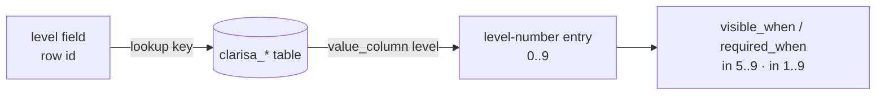

# Design — QA catalog level rules on level numbers (P2-3939)

## 1. Document Control

| Field | Value |
|---|---|
| Spec Path | `bugfix/p2-3939-qa-catalog-level-numbers` |
| Type / Depth | Bug (Bug Mode) · Lite |
| Requirements | `requirements.md` (LVL-R-1..6) |
| Verified at | `b143445bd` (branch `qa-development-2026-ss`) |
| Backend route | `nestjs-expert` — project Skill Map; no `references/backend-routing.md` decision changes the lead (catalog definitions are data, not modules) |
| Status | approved — 2026-11-23 |

## 2. Executive Summary

Add five read-only **level-number** entries bound with the existing `lookup` storage kind (`clarisa_*` row → its `level` column) and restate the level rules on them. Nothing stored changes; the existing level fields keep their row-id values and lists. Version 2026.35 → 2026.36.

## 3. Architecture Overview

No new module. The change lives in the catalog **definitions** (data) and the lookup **source registry**; the existing value pipeline (`qa-results` → `value-reader` → `lookup.resolver`) already fills top-level and sibling lookups in one batched SELECT per source.

## 4. Extended Directory Structure

| Path | Change |
|---|---|
| `onecgiar-pr-server/src/api/qa-catalog/values/lookup-sources.ts` | +2 sources |
| `.../definitions/sections/innovation-use.ts` | +1 field, rule re-keyed, D28 note removed |
| `.../definitions/sections/ipsr-step-3.ts` | +2 top-level fields, +2 complementary subfields, rules on 4 evidence lists and 3 current-use lists, header gap note rewritten |
| `.../definitions/closed-control-lists.ts` | D28 reference in the comment removed |
| `.../definitions/versions.ts` | revision 35 → 36 |
| `.../*.spec.ts`, `__snapshots__/qa-catalog.snapshot.json` | pins updated + regression test |
| `onecgiar-pr-server/docs/qa-catalog.en.md` | rules, gap, change-log v1.36 |

## 5. Data Model

No schema change, no migration (LVL-NFR-2). Read only: `clarisa_innovation_use_levels(id, level)`, `clarisa_innovation_readiness_level(id, level)`.

## 6. API Design

`GET /api/qa/catalog`: five additive entries + changed conditions. `GET /api/qa/results`: values for the five entries (number or empty). No route, DTO or Swagger change (entries are catalog data).

## 7. Backend Module Design — Design Decisions

| ID | Decision | Satisfies | Rejected alternative |
|---|---|---|---|
| **DD-1** | New entries, `type: 'number'`, `required: false`, read-only, `storage.kind: 'lookup'`, `keys: [{ from: <level key>, to: 'id' }]`, `value_column: 'level'`. Keys: `innovation_use.use_level.innovation_use_level_number`, `ipsr_step_3.core.readiness_level_number`, `ipsr_step_3.core.use_level_number` (top-level, same section / result types / phase scope as their level field, ordered right after it); subfields `readiness_level_number`, `use_level_number` inside `ipsr_step_3.complementary_components` (lookup `from` = sibling `readiness_level` / `use_level`). Label: "Level number (read-only)" style, no form label — same convention as `requires_description` (P-9). | LVL-R-1 | Normalizer on the existing value (proposal option C) breaks the `control_list` contract; `in` over row ids (option B) is environment-dependent (P-5) |
| **DD-2** | Register `prms.clarisa_innovation_use_levels` (table `clarisa_innovation_use_levels`, PK `id`) and `prms.clarisa_innovation_readiness_level` (table `clarisa_innovation_readiness_level`, PK `id`) in `LOOKUP_SOURCES`. | LVL-R-1, NFR-3 | — |
| **DD-3** | Innovation Use explanation: `visible_when` = `required_when` = `in(innovation_use_level_number, [5..9])`; `required_confirmed` unchanged (`false`). | LVL-R-2 | — |
| **DD-4** | Evidence lists (core ×2, complementary ×2): `required_when: in(<own level number>, [1..9])`; **no** `visible_when`; `required: false` unchanged; the two core lists keep `required_confirmed: true` (the function states the same `level != 0`, P-7); the two complementary lists are relation subfields and carry no `required_confirmed` property (validation W-1, 2026-11-23; recorded in `execution.md` LVL-T-2). | LVL-R-3 | `any[eq 0 …]` negation — vocabulary has no `not` (P-6) |
| **DD-5** | `core.current_use.actors|organizations|measures`: `visible_when: in(ipsr_step_3.core.use_level_number, [1..9])`; required flags and row rules unchanged. Keyed on the **evidence-based** `core.use_level`, not `current_use_level` (P-8). | LVL-R-4 | — |
| **DD-6** | NULL level not stated (complementary evidence; core unset). Contract keeps one narrowed gap (LVL-R-6). | LVL-R-6 | Inventing an `is_null` operator — out of scope (contract-wide) |
| **DD-7** | `CATALOG_VERSIONS[2026].revision` 35 → 36; contract change-log row v1.36 naming P2-3939, the 5 keys, the corrected IU rule, the stated S3 rules and the residual gap. Re-check the free revision at merge (proposal R-1). | LVL-R-5 | — |
| **DD-8** | Regression test: a test-local evaluator for the three operators (`eq`/`in`/`not_null`) applies the catalog's **own** condition to values produced by the real `lookup.resolver` over a stubbed query runner (rows: id 5 → level 4, id 10 → level 9, id 13 → level 2). Red on current code because the rule reads the row id (5 ∈ [5..9]). | LVL-R-2, R-3 | Asserting only the condition JSON — a presence check, cannot show the id/number mismatch |

### Step 2.3 — Reversion challenge

DD-4 removes a delivered guard: `qa-catalog.ipsr-step-3.spec.ts:221-226` throws if any level gate is stated on an evidence list. **What does removing it break?** The guard prevents comparing numbers with row ids. Replacement: the spec asserts the gate exists **and** that its `field` is the level-number lookup (storage `lookup`, `value_column: 'level'`), so a gate re-pointed at the row-id field still fails. No other breakage found (P-10 consumers are only catalog specs).

## 8. Frontend / UX

n/a — backend-only; no client change.

## 9. Shared Contracts

`onecgiar-pr-server/docs/qa-catalog.en.md` is the contract of record. External consumer (QA app) re-reads on the version change (P-11).

## 10. Budget (Step 2.4)

| Expected tasks | Expected LOC | Expected review rounds |
|---|---|---|
| 3 | ~260 (defs ~80, tests ~130, doc ~50) | 4 |

Matches Lite-plus; no depth change. Tripwire: > 4 tasks or > 400 LOC → escalate.

## 11. Premise Ledger

Count: 13 rows — 10 verified, 3 `UNVERIFIED` (High 0, Low 3) — P-5, P-7 (VS3), P-12 (external QA app) (corrected by validation W-2, 2026-11-23).
Blast-radius triggers: `live-path` (GET catalog/results), `shared-state` (the level fields read by several lists), `consumer` (catalog keys / response shape) — all fired, rows P-9..P-11.

| # | Claim | Class | Citation (as run) | Verified at | If false | Settled by |
|---|---|---|---|---|---|---|
| P-1 | Innovation Use stores the level **row id** | location | `innovation-use.service.ts:131-140` (`findOne({ where: { level } })` → `innovation_use_level = use_levels.id`), saved `:200`, `:244` | b143445bd | High — no bug; spec unnecessary | — |
| P-2 | The explanation rule compares `in [5..9]` on the field bound to `innovation_use_level_id` | location | `qa-catalog/definitions/sections/innovation-use.ts:596`, `:618-627` | b143445bd | High — DD-3 moot | — |
| P-3 | The lookup resolver fills top-level lookup fields and sibling lookup subfields | existence | `values/lookup.resolver.ts:93` (`topLevel: d.subfieldPath.length === 0`); `lookup.resolver.spec.ts:225` ("a top-level lookup field"); shape rule DD-13 `shape-validator.ts:465-485` | b143445bd | High — DD-1 needs a new binding kind | — |
| P-4 | Both level tables have a `level` column | data-env | `clarisa-innovation-use-level.entity.ts:10-15`; `clarisa-innovation-readiness-level.entity.ts:8-12` | b143445bd | High — DD-1 has no value column | — |
| P-5 | Row ids ≠ level numbers and repeat (test DB: use ids 1–10 = 0–9, 13–20 = 2–9; readiness 11–20 = 0–9) | data-env | `UNVERIFIED — confirm at source before relying on it` (secondary: `ipsr-step-3.ts:27-29` note "read 2026-10-09 on the test DB"; prod never read) | — | Low — design unchanged (lookup reads `level` whatever the id); only fixture realism | user (one `SELECT id, level` on test + prod) at the execute pre-flight |
| P-6 | Condition vocabulary is `eq` / `in` / `not_null` | other | `definitions/types.ts:152`; `shape-validator.ts:59` | b143445bd | Low — DD-4/DD-6 could use `not`/`is_null` | — |
| P-7 | The live functions gate on the level **number**: VIU via `clarisa_innovation_use_levels.level` by id; VS3 `level != 0` (complementary also NULL) | data-env | VIU: `docs/specs/changes/innovation-use-nature-all-actors/sql/validation_innovation_use_P25.after.prod.sql:82-86` (`SELECT ciul.level … WHERE ciul.id = innovation_use_level_id`). VS3: `UNVERIFIED — confirm at source before relying on it` (only `ipsr-step-3.ts:26-27` comment citing VS3:19-47, 231-264; no VS3 SQL in the repo: `git ls-files \| grep -i validation_ipsr_step_three` → 0 hits) | b143445bd (VIU) | Low — DD-4 `required_confirmed` flips to `false` | T-2 first step: read VS3 on the test DB (`SHOW CREATE FUNCTION`) or user |
| P-8 | Form hides current use when the core **evidence-based** use level is at list index 0; evidence required when its level index ≠ 0 (unset → -1 → required) | location | `step-n3.component.ts:78-84`, `:182-184`; `step-n3.component.html:61-63`, `:38`, `:55` | b143445bd | High — DD-5 keyed on the wrong field | — |
| P-9 | `requires_description` is the precedent for a read-only lookup subfield driving a sibling condition | other | `general-information.ts:447-458`, `:468-474` | b143445bd | Low — label/flag convention only | — |
| P-10 | **live-path**: `GET /api/qa/catalog` → `qa-catalog.controller.ts:60` → `QaCatalogService` → section definitions; values: `GET /api/qa/results` → `qa-results.service.ts` → `value-reader` → `lookup.resolver.ts` | live-path | `qa-catalog.controller.ts:60-61` (`@Get('catalog')`); resolver header `lookup.resolver.ts:1-9` | b143445bd | High — patch off-path | — |
| P-11 | **shared-state**: `ipsr_step_3.core.use_level` is read by `core.use_evidences` and `core.current_use.actors|organizations|measures`; `core.readiness_level` by `core.readiness_evidences`; complementary `readiness_level` / `use_level` by their sibling evidence lists; `innovation_use_level` by `readiness_level_explanation` only | shared-state | `ipsr-step-3.ts:351-404`, `:407`, `:508`, `:583`, `:665-720`; `innovation-use.ts:599-631` | b143445bd | Low — a reader missed | — |
| P-12 | **consumer**: in-repo readers of the changed keys are catalog specs + snapshot only | consumer | `git grep -n "readiness_level_explanation\|innovation_use\.use_level\.\|ipsr_step_3\.core\.\(readiness\|use\)_\(level\|evidences\)\|core\.current_use\." -- . ':!onecgiar-pr-server/src/api/qa-catalog/definitions' ':!*.json'` → code hits only in `qa-catalog.display-rules.spec.ts:76`, `qa-catalog.required-follows-form.spec.ts:130`, `qa-catalog.ipsr-step-3.spec.ts` (+ docs/inventory, historical); plus `__snapshots__/qa-catalog.snapshot.json`, `qa-catalog.controller.spec.ts:134` (version `2026.35`). External QA app: `UNVERIFIED — confirm at source before relying on it` | b143445bd | Low — an extra spec to update | user (QA app owner notified via change log) |
| P-13 | A `number` field may be compared with `in` without a closed-list check | other | `shape-validator.ts:114-116` (non-select types return early) | b143445bd | Low — would need `single_select` + closed list | — |

Hand-off: P-5 → execute pre-flight (user); P-7 VS3 → T-2 first step; P-12 → `Consumers` of T-1..T-3.
