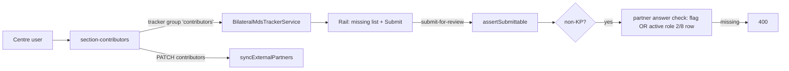

# Design — Bilateral External partners back in the MDS

## Document Control

| Field | Value |
|---|---|
| Spec Path | `changes/bilateral-partners-mds` |
| Depth | Standard |
| Verified at | `14528d560` (onecgiar_pr) |
| Requirements | `requirements.md` BPX-R-1..R-10 |
| Supersedes | `bilateral/contributors-partners-optional` — BIL-DD-1, BIL-DD-2 |
| Skills | `angular-developer`, `nestjs-expert`, `tdd` (Skill Map) |

## 1. Summary

There are three independent changes and one documentation change:

1. **Client** (`section-contributors`):
   - move the partners block into Block 1 for every type;
   - restore the `external-partners` tracker item for non-KP, editable results;
   - re-publish the tracker when editability changes;
   - drop partners from the hidden-fields note;
   - hide the Full metadata toggle when the type has nothing left behind it.
2. **Server** (`bilateral-center.service.ts`): a persisted partner-answer check inside `assertSubmittable`, for non-KP results.
3. **PDF** (`alliance-ibd-pdf-viewer`, another repo): stop removing the non-KP Partners table in the MDS-only bilateral template.
4. **Docs**: supersession notes.

There is no migration, no DTO change and no `/api/bilateral/*` shape change.

## 1A. Premise Ledger

Count: 13 verified · 0 `UNVERIFIED`.
Blast-radius triggers: `live-path` (submit action) · `shared-state` (`assertSubmittable` serves 3 callers; the tracker group is read by the rail) · `consumer` (tracker key `external-partners`, `showFullMetadata`, `hiddenFieldsWithValues`).

| # | Claim | Class | Citation (as run) | Verified at | If false | Settled by |
|---|---|---|---|---|---|---|
| P-1 | The partners block renders only inside the `showFullMetadata()` container | location | `section-contributors.component.html:303-312` | 14528d560 | DD-1 targets the wrong markup (High) | — |
| P-2 | The tracker publishes only `lead-center` / `lead-project` for section 2; `external-partners` was removed by P2-3821 | existence | `section-contributors.component.ts:997-1015`; `git show 9be3db51e` (removed block quoted there) | 14528d560 | DD-2 duplicates an item (Low) | — |
| P-3 | `readOnly()` = `!isEditableByCenterUser() \|\| autoSave.isReadOnly()`, a computed signal | location | `section-contributors.component.ts:89` | 14528d560 | DD-2's editability scope reads the wrong signal (High) | — |
| P-4 | `updateContributorsMds()` is called imperatively (5 sites), never from an effect that tracks `readOnly()` | shared-state | `grep -n "updateContributorsMds()" section-contributors.component.ts` → 884, 976, 1076, 1105, 1119 | 14528d560 | No re-publish needed; DD-2 drops the effect (Low) | — |
| P-5 | Knowledge Products render this same section | live-path | `bilateral-result-creator.component.html:280` (no type gate around `app-section-contributors`); KP predicate `bilateral-creation.service.ts:86` | 14528d560 | KP exemption unnecessary (Low) | — |
| P-6 | Without partners, the Full metadata container would hold only the linked question, which is hidden for Innovation Use (2) and Innovation Development (7) | shared-state | `section-contributors.component.html:303-460` (contents: intro line, partners block, `@if (showLinkedResultQuestion())`); `section-contributors.component.ts:703` | 14528d560 | DD-3 is unnecessary (Low) | — |
| P-7 | The "none" answer persists as `result.no_applicable_partner` (boolean, default false); partners persist as `results_by_institution` with role 2, or 8 when a `results_knowledge_product` row exists; ticking "none" deactivates the active partner rows | location | `result.entity.ts:377-382`; `bilateral-center.service.ts:2081-2113` | 14528d560 | DD-4's predicate misses answers (High) | — |
| P-8 | `assertSubmittable` is the shared precondition of submit (2454), the AI quality assessment (2787) and the field-revision audit (2861) | shared-state | `grep -n "assertSubmittable(" bilateral-center.service.ts` → 2454, 2685 (def), 2787, 2861 | 14528d560 | Gate placed in the wrong method (High) | — |
| P-9 | The service already injects `resultByIntitutionsRepository` and `resultRepository` | existence | `bilateral-center.service.ts:117-118`; `assertSubmittable` loads `result` at 2700 | 14528d560 | New DI wiring needed (Low) | — |
| P-10 | No E2E or Cypress spec references the partners block or the changed symbols | consumer | `grep -rn "external-partners\|showFullMetadata\|hiddenFieldsWithValues\|sc-block--partners\|This result has no external partners" onecgiar-pr-client/src onecgiar-pr-client/cypress` → hits only in `section-contributors.component.{ts,html}`, `.component.spec.ts` (≈30 lines) and `.readonly.spec.ts:310` | 14528d560 | Extra consumers to update (Low) | — |
| P-11 | Server specs reach `assertSubmittable` through mocked repositories (19 references in `bilateral-center.service.spec.ts`); a new repository read will need mock defaults | consumer | `grep -rn "assertSubmittable" --include=*.spec.ts onecgiar-pr-server/src/api/bilateral/services \| wc -l` → 19 | 14528d560 | Existing submit tests break (Low) | — |
| P-12 | The MDS-only PDF removes the non-KP partners in `results_bilaterals_p25/components/common-sections.tsx` of `alliance-ibd-pdf-viewer`: `ContributorsSection` builds its Partners rows from `kp_partner_data` only, and commit `827f180` (INC-168048) dropped the `...(data.non_kp_partner_data ?? [])` spread that preceded `...(data.kp_partner_data ?? [])` | location | `alliance-ibd-pdf-viewer` `common-sections.tsx:164-172` (`kpPartners`, `hasPartners`, `hasAnything`) and `:255-268` (table); `git show 827f180 -- …/common-sections.tsx` diff lines 87-88 (removed spread) | pdf-viewer `b5e092d` (main) | BPX-T-3 edits the wrong file (High) | — |
| P-13 | A rejected result is editable by the centre user (`isEditableByCenterUser` true for Editing, Draft, Rejected, and for a not-yet-loaded null status) | data-env | `bilateral-creation.service.ts:536-544` | 14528d560 | BPX-R-3 scenario 2 needs another trigger (Low). Note: a null status counts as editable, so the item registers while loading and the DD-2 effect withdraws it if the status lands read-only | — |

## 2. Architecture Overview

## 3. Data Model Changes

None. The design reads `result.no_applicable_partner` and `results_by_institution` (`is_active`, `institution_roles_id`) as they are today (P-7).

## 4. API Surface

| Endpoint | Change |
|---|---|
| `POST /api/bilateral/center/submit-for-review/:id` (and the QA-assessment and field-revision endpoints that share `assertSubmittable`) | New 400 for a non-KP result with no partner answer. Same error envelope as every other precondition |
| `POST /api/bilateral/create` | None (BPX-R-10) |

Bilateral payload doc: no change-log row, because no request or response shape changes. The refusal is on the centre endpoints, not on the documented ingest or read contract.

## 5. Server Workflow

`assertSubmittable` order after this change: id → load → status → permission → owner/primary SP → **partners (non-KP)** → Innovation Use MDS. The partners check:
- reads `result.no_applicable_partner` from the row already loaded;
- if that is not true, counts active `results_by_institution` rows for the result with `institution_roles_id IN (2, 8)`;
- zero → `BadRequestException('External partners: select at least one external partner, or tick "This result has no external partners".')`.

KP results (`result_type_id === ResultTypeEnum.KNOWLEDGE_PRODUCT`) skip the check. Backend route: `nestjs-expert` · test-first (`tdd`).

## 6. Frontend Plan

| Change | Where |
|---|---|
| Move the partners block (checkbox, multi-select, chips, `partnersLoadFailed` banner) into Block 1, after the projects block and before the MDS banner | `.html` 260-272 → new position; delete it from 312-376 |
| Required affordance on non-KP results: `[required]="isPartnerRequired()"` on the multi-select, plus the red hint while editable, non-KP and unanswered | `.html` partner block |
| `isPartnerRequired = computed(!readOnly() && !creationService.isKnowledgeProduct())` | `.ts` |
| Tracker: add `external-partners` (`filled: partnersHydrated() && externalPartnersSatisfied()`) to the `contributors` group only when `isPartnerRequired()` | `updateContributorsMds()` |
| An effect that tracks `isPartnerRequired()` and calls `updateContributorsMds()`, so a readOnly flip after load re-publishes | `.ts` |
| `hiddenFieldsWithValues` returns to counting the linked question only | `.ts` |
| `hasFullMetadataFields = computed(!linkedQuestionOwnedElsewhere())`. The toggle button, the hidden-fields note and the Full metadata container render only when it is true. When false, the banner reads only its first sentence | `.ts`, `.html` 272-310 |

Design route: no new component and no tokens. Existing `pr-multi-select` / `pr-checkbox` / `app-alert-status` with the pre-P2-3821 markup (`git show 9be3db51e^:…section-contributors.component.html`). Page mode: form (existing). Skill: `angular-developer`.

## 7–9. Security · Performance · Observability

- **Security:** no auth change. The gate sits after the permission check, so an unauthorised caller still gets the existing refusal first.
- **Performance:** at most one extra indexed count per submit (`result_id` index on `results_by_institution`). The flag comes from the already-loaded row.
- **Observability:** no new logs.

## 10. Testing Plan

| Suite | Cases |
|---|---|
| Server `bilateral-center.service.spec.ts` | Non-KP with no flag and no rows → 400; flag true → passes; one active role-2 row → passes; one active role-8 row → passes; inactive row only → 400; KP with nothing → passes; the 400 fires before the IU validator and no history is written |
| Client `section-contributors.component.spec.ts` | Tracker item present for an editable non-KP result, absent for KP and for read-only; filled only when hydrated and answered; re-published on a readOnly flip; hidden-fields count ignores partners; `hasFullMetadataFields` false for types 2 and 7 |
| Client `.readonly.spec.ts` | Read-only non-KP result with no answer: no item, no hint |
| Static template read | The partner block sits outside the `@if (hasFullMetadataFields() && showAllFields())` container |
| Build | `npx ng build` (client), `npx tsc --noEmit` (server) |

## 11. Backwards Compatibility

- Existing results in Editing, Draft or Rejected without a partner answer now need one before Submit. This is the intended behaviour, and BPX-OQ-1 defaults to no notice.
- Results already in Pending Review or later are untouched.
- Rollback: revert the commits. There is no data written to undo.

## 12. Design Decisions

### BPX-DD-1 — The block lives in Block 1 for every type

Required only for non-KP. Showing it to KP results keeps one layout. KP partners stay optional because their source is the repository (BPX-R-4).
**Reversion challenge (Step 2.3):** this reverts BIL-DD-2's placement. *What does removing it break?* → the Full metadata container empties for types 2 and 7 (P-6). That is addressed by DD-3.

### BPX-DD-2 — Tracker item scoped to `isPartnerRequired()`, re-published by an effect

This restores P2-3443's item and its hydration invariant. Scoping it to editable results is what prevents the #9503 dead end, which P2-3821 fixed by removing the item entirely.
**Reversion challenge:** this reverts P2-3821's removal. *What does removing the "no item" behaviour break?* → read-only ingested results would be held incomplete. That is addressed by the `!readOnly()` scope plus the effect, since `updateContributorsMds` is otherwise only called imperatively (P-4).
*Rejected:* registering the item always and filtering in the rail. That changes a shared service for one field.

### BPX-DD-3 — Hide the Full metadata toggle when the type has nothing behind it

After DD-1, Innovation Use and Innovation Development have no Full metadata field in section 2 (P-6). The toggle, the note and the container render only when `hasFullMetadataFields()` is true, and the banner drops "Add the full metadata if you need to report more." for those types.
*Rejected:* leaving an empty toggle, which shows a button that opens nothing.

### BPX-DD-4 — The server predicate reads persisted rows, not the form state

The check is: flag true, **or** at least one active role 2/8 row. That mirrors exactly what the form's PATCH writes (P-7), so the server and the tracker agree. It lives in `assertSubmittable` (P-8), so the AI quality check cannot pass a result that submit would then refuse.
*Rejected:*
- reusing the SQL `validation_partners_*` functions: their state is applied by hand, and they add the `is_leading_result` rules, which are not part of this MDS;
- a new validator service, which is too much for one check.

### BPX-DD-5 — Ingest stays optional

This is Option A of the proposal. AC-4 holds, and the Fetcher (other repo) is untouched.

## 13. Budget (tripwire for `/akili-execute`)

| Measure | Estimate |
|---|---|
| Tasks | 4 |
| LOC | ~380 (server ~40 + tests ~110; client ~70 + tests ~140; PDF ~10; docs ~10) |
| Review rounds | 5 |

## 14. Open Gaps

- None from the Premise Ledger. P-12 was settled on 2026-11-18 against `alliance-ibd-pdf-viewer` `b5e092d` (cloned at `D:\Desarrollo Empresa\alliance-ibd-pdf-viewer`).
- BPX-OQ-1 and BPX-OQ-2 carry defaults: no notice, no ingest rule.
