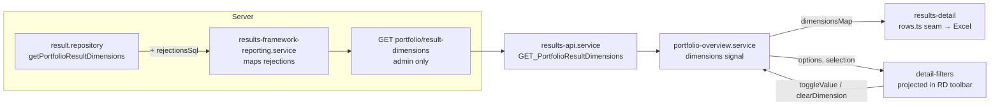

# Design — Results detail filters and rejection reason in the Portfolio Overview export

> **Answer first:**
> - **Server:** one more query in `getPortfolioResultDimensions`'s `Promise.all`, returned as `rejections[]` on the existing admin endpoint.
> - **Client data:** the export's pure seam (`results-detail.rows.ts`) resolves three new fields for rows in status Rejected.
> - **Client UI:** a small presentational `app-portfolio-detail-filters` (Spartan Popover + Command, the same pattern as the top-bar multi-select) holds Funding + Status. The page **projects it into the Results detail toolbar** and binds it straight to the service's `selection` / `toggleValue` / `clearDimension`, so no filter state is added anywhere.

## 1. Document Control

| Field | Value |
|---|---|
| Spec Path | `changes/portfolio-rejection-reason-export` |
| Type / Deliverable / Depth | Change / software / Standard |
| Approval Mode | gated |
| Requirements | `requirements.md` (PRE-R-1..9), approved 2026-11-17 |
| Verified at | `385d46e44` |
| Skills | `nestjs-expert`, `api-design-principles` (server) · `angular-developer`, `spartan`, `tailwind-design-system`, `impeccable-bridge` (client) |
| Architecturally significant | No (an additive field on an existing endpoint, one presentational component) |

## 2. Executive Summary

| Concern | Decision |
|---|---|
| Where the reason comes from | Newest `REJECT`/`REJECTED` row in `result_review_history` for results currently at `status_id = 7` (DD-1, DD-3) |
| How it reaches the client | `rejections[]` on `portfolio/result-dimensions` (already loaded once per phase, admin-only) (DD-1) |
| How it enters the file | `buildDetailLabels` → `toDetailRows` → `toExportRows`, 16 columns (DD-6) |
| Filters UI | New `app-portfolio-detail-filters`, projected into the detail toolbar via `<ng-content>` (DD-4, DD-5) |
| State | None new: the page passes `data.options()`, `data.selection()` and calls `data.toggleValue` / `data.clearDimension` (DD-5) |

## 3. Architecture Overview



## 4. Extended Directory Structure

```text
onecgiar-pr-server/src/api/
  results/result.repository.ts                                  (M) + rejectionsSql in getPortfolioResultDimensions
  results-framework-reporting/results-framework-reporting.service.ts (M) map rejections
  results-framework-reporting/dto/portfolio-result-dimensions.dto.ts (M) + PortfolioRejectionDto, rejections
  results-framework-reporting/results-framework-reporting.controller.ts (M) Swagger description
onecgiar-pr-client/src/app/
  shared/interfaces/portfolio-result-dimensions.interface.ts    (M) + DimensionRejection, rejections
  internationalization/portfolio-overview.copy.ts               (M) detail.filters* + export headers
  pages/result-framework-reporting/pages/portfolio-overview/
    portfolio-overview.component.html                           (M) project <app-portfolio-detail-filters>
    portfolio-overview.component.ts                             (M) import component
    components/results-detail/results-detail.rows.ts            (M) rejection fields + 16 export columns
    components/results-detail/results-detail.component.html     (M) <ng-content select="[detailFilters]"> in toolbar
    components/results-detail/results-detail.component.ts       (M) widths for the new columns
    components/detail-filters/detail-filters.component.{ts,html,spec.ts}  (A)
```

## 5. Data Model

No schema change and no migration. The design reads existing columns:

| Table | Columns read | Why |
|---|---|---|
| `result` | `id`, `version_id`, `is_active`, `status_id`, `result_type_id` | Scope (the same filters as the existing arrays) + `status_id = 7` |
| `result_review_history` | `result_id`, `action`, `comment`, `initiative_id`, `created_at`, `id` | Newest rejection record |
| `clarisa_initiatives` | `id`, `official_code`, `name` | `Rejected by` label |

## 6. API Design

`GET api/results-framework-reporting/portfolio/result-dimensions?versionId=` — unchanged route, guard and errors. **Additive** response field:

| Field | Type | Meaning |
|---|---|---|
| `rejections` | array | One item per active, in-scope result of the version at status Rejected that has a rejection record |
| `rejections[].resultId` | number | `result.id` (joins the page rows' `id`) |
| `rejections[].comment` | string \| null | The trimmed comment, or null |
| `rejections[].programCode` | string \| null | `official_code` of the deciding SP; null when `initiative_id` is null |
| `rejections[].programName` | string \| null | `name` of the deciding SP |
| `rejections[].rejectedAt` | string | `YYYY-MM-DD`, formatted in SQL (DD-7) |

Objects rather than positional tuples: this list is small and has five fields, so named keys stay readable. The positional pairs exist for the large link lists (GLF).

## 7. Backend Module Design

**Backend route:** `nestjs-expert` + `api-design-principles`; test-first not required (a mapping with no branching beyond null coalescing); `none — project conventions` for the raw SQL style (the repository already uses `this.query`).

- **Repository:** add a fifth query to the existing `Promise.all`. Scope = the same `WHERE` as `projectLinksSql` (version, `is_active`, types not 10/11), plus `status_id = 7`. It joins the newest reject row per result, chosen by a correlated sub-select ordered `created_at DESC, id DESC` with limit 1 (DD-3). The SP comes from a `LEFT JOIN clarisa_initiatives`, and `DATE_FORMAT` gives the day. Same error wrapper (`debug: false`).
- **Service:** map rows to `{ resultId: Number, comment: trimmed or null, programCode, programName, rejectedAt }`. Never log the comment. The existing catch already returns a generic 500.
- **DTO / Swagger:** `PortfolioRejectionDto` plus `rejections` on `PortfolioResultDimensionsResponseDto`; append one sentence to the operation description.

## 8. Frontend / UX Component Architecture

**Design route:** `impeccable-bridge` (ENV per *Environment classification*: existing product, existing tokens, page mode **dashboard/tool**). Direction = **match the existing top-bar multi-select** (no new visual language). Stack: `angular-developer`, `spartan`, `tailwind-design-system`.

### 8.1 `app-portfolio-detail-filters` (new, presentational)

| Aspect | Decision |
|---|---|
| Inputs | `fundingOptions: FilterOption[]`, `statusOptions: FilterOption[]`, `fundingSelected: ReadonlySet<string>`, `statusSelected: ReadonlySet<string>`, `disabled: boolean` |
| Outputs | `toggled: { dimension: 'funding' \| 'status'; value: string }`, `cleared: void` |
| Own state | `open` only (like `FilterMultiSelectComponent`) |
| Trigger | Outline button styled like the `hlmBtn variant="outline"` Export button, label `Filters`, count badge = funding + status size, chevron. `aria-haspopup`, `aria-expanded`, `aria-controls`, accessible name `Filters, N selected` |
| Panel | `hlm-popover` + `brnCommand` list (the same structural-directive caveats documented in `filter-multi-select.component.html`). Two `brnCommandGroup` sections, **Funding** and **Status**, with check-style items. A footer row holds the hint line (PRE-R-4) and a **Clear** button (disabled when both are empty) |
| Keyboard | Inherited from Brain Command/Popover: arrows move, Enter/Space toggle, Escape closes. Focus returns to the trigger on close (verified in a test, PRE-R-6) |
| Width | Panel `280px`, `max-w-[calc(100vw-32px)]`; trigger auto width |
| Tokens | Existing `--pr-*` tokens only (border, surface-card, text-heading, primary-50/600 for the badge, focus ring). No new tokens |

### 8.2 Results detail toolbar

`results-detail.component.html` adds `<ng-content select="[detailFilters]" />` between the Search box and the Export button. The toolbar's flex-wrap keeps its current wrap behavior.

### 8.3 Page wiring

In `portfolio-overview.component.html`, inside `<app-portfolio-results-detail>`, add `<app-portfolio-detail-filters detailFilters …>` with:

- `fundingOptions = data.options().funding`
- `statusOptions = data.options().status`
- `fundingSelected = data.selection().funding`, `statusSelected = data.selection().status`
- `disabled = data.filtersPending()`
- `(toggled) → data.toggleValue(e.dimension, e.value)`
- `(cleared) → data.clearDimension('funding'); data.clearDimension('status')`

### 8.4 Export seam (`results-detail.rows.ts`)

- `DetailLabels` gains `rejections: ReadonlyMap<number, {reason, by, on}>`, built in `buildDetailLabels`. The `by` label uses the shared `scienceProgramLabel(code, name)` (same as the notice); empty becomes `—`.
- `DetailRow` gains `rejectionReason`, `rejectedBy`, `rejectedOn` (screen columns unchanged).
- `toDetailRows`: when the row's resolved status slot is not `rejected` → `—` ×3. When it is `rejected`: map not ready → `Unavailable` ×3; map ready and a record exists → the values (`—` for each missing one); no record → `—` ×3.
- `EXPORT_COLUMNS` inserts the three headers after `Status`; `toExportRows` writes them and truncates `Rejection reason` to 32,767 characters (DD-8).
- `EXPORT_WSCOLS`: `Rejection reason` width 60, the other two 20.

### 8.5 UI states

| State | Filters button | Export |
|---|---|---|
| Loading page | Not rendered (the block is inside `hasFigures()`) | Unchanged |
| Filters pending | Disabled | Disabled (existing) |
| Empty filtered list | **Enabled** | Disabled (existing) |
| Map error | Enabled; rejection cells `Unavailable` | Enabled |
| 0 results for the global selection | Not rendered: the block is unmounted by the existing mount rule (FDE R-9), and the no-match panel's Clear all plus the top bar widen the selection | Not rendered |

*Amended 2026-11-17 (execute-time, PRE-T-3):* "Empty filtered list" above is the table's own search-no-match state. The last row records the existing mount rule, which this spec keeps (see `requirements.md` PRE-R-5 note).

## 9. Shared Contracts or Package Extensions

`PortfolioResultDimensions` (client) and `PortfolioResultDimensionsResponseDto` (server) gain `rejections`. Both are additive. Client code that builds the map by hand (specs) must add `rejections: []` wherever the type is strict (consumer list in P-8).

## 10. Design Decisions

| ID | Decision | Rejected alternatives | Requirements |
|---|---|---|---|
| DD-1 | Serve rejections on the existing dimensions endpoint | A new endpoint (a second request plus its own state); a per-row history call (N requests) | PRE-R-7, R-8 |
| DD-2 | Objects, not positional tuples, for `rejections` | Tuples (unreadable with 5 fields) | PRE-R-8 |
| DD-3 | Newest = `created_at DESC, id DESC`, mirroring the notice's `sortReviewHistoryNewestFirst` | `MAX(id)` (can differ from what the notice shows) | PRE-R-7 |
| DD-4 | A new presentational component in the top-bar multi-select's pattern | Reusing `FilterMultiSelectComponent` (one dimension per instance, emits a value only, groups add an "All" item) | PRE-R-1, R-6 |
| DD-5 | Content projection plus direct page binding to the service | Pass-through inputs/outputs on results-detail (more surface); injecting the service into results-detail (breaks its presentational contract, FDE) | PRE-R-2, R-3 |
| DD-6 | Insert the 3 export columns after `Status` | Appending before `Link` | PRE-R-7 |
| DD-7 | Format `rejectedAt` in SQL as `YYYY-MM-DD` | A client `Date` (time-zone shift near midnight) | PRE-R-7 |
| DD-8 | Truncate in `toExportRows` (the sink) | Truncating on the server (the API would lose data) | PRE-R-9 |
| DD-9 | Lean on the existing guards for PRE-R-8's `AND IT MUST` (no new guard or handler) | — | PRE-R-8 |

### Reversion challenge (Step 2.3)

- **DD-6** shifts the positions of the existing columns from `Origin` onward by 3. *What does this break?* Any user spreadsheet or macro that reads the export by column letter. There is no in-repo consumer (P-9). **Accepted:** the requester asked for the reasons in this table, and placing them beside Status is what reading a row needs. Mention the column change in the ticket reply.
- No other DD removes or inverts shipped behavior.

## 11. Premise Ledger

Count: **9 verified · 1 UNVERIFIED (Low: 1, High: 0)**
Blast-radius triggers: **live-path** (user action: Filters tick → page filters; Export click), **consumer** (response shape `PortfolioResultDimensions`, exported `EXPORT_COLUMNS` / `DetailRow`, new DOM hook in the detail toolbar), **shared-state** (the global `selection` signal is read by every block).

| # | Claim | Class | Citation (as run) | Verified at | If false | Settled by |
|---|---|---|---|---|---|---|
| P-1 | Every write of `status_id = 7` also writes a `REJECT` history row in the same transaction | existence | `grep -rnE "status_id\s*[:=]\s*(ResultStatusData\.Rejected\.value\|7)\b\|newStatusId = ResultStatusData\.Rejected" onecgiar-pr-server/src --include=*.ts` (spec and comparison lines excluded) → 2 writers: `results.service.ts:4403` (history at `:4415-4421`) and `share-result-request/services/primary-program-request.service.ts:1163` (history at `:1170-1178`) | 385d46e44 | DD-1: rejected rows without a record would show `—`; PRE-R-7's `—` fallback already covers it (Impact Low) | — |
| P-2 | The REJECT comment is mandatory on the review path; the decline path writes a composed sentence | data-env | `results.service.ts:4366-4373` (`'Justification is required when decision is REJECT'`); `primary-program-request.service.ts:1174` | 385d46e44 | No change (the fallback exists) — Low | — |
| P-3 | Legacy rows can use `REJECTED` and have a null `initiative_id` | data-env | `onecgiar-pr-client/src/app/pages/bilateral/services/bilateral-review-history.interface.ts` `isRejectAction` and the `ReviewHistoryEntry` doc comment | 385d46e44 | DD-3's SQL must accept both spellings (already in scope) — Low | — |
| P-4 | The `clarisa_initiatives` code/name columns are `official_code`, `name` | location | `onecgiar-pr-server/src/clarisa/clarisa-initiatives/entities/clarisa-initiative.entity.ts:10,21,27` | 385d46e44 | The SQL column names change — Low | — |
| P-5 | Live path for Filters: the page renders `<app-portfolio-results-detail [rows]="data.filteredRows()">` inside `hasFigures()`; `filteredRows` derives from `selection`; `toggleValue` / `clearDimension` replace `selection` | live-path | `portfolio-overview.component.html:376-383`; `services/portfolio-overview.service.ts:218,245-248,558-567` | 385d46e44 | DD-5 binding target changes — High | — |
| P-6 | Live path for Export: Export click → `exportToExcel` → `ExportTablesService.exportExcel(toExportRows(listed()), …, {exactFileName})`; `listed` derives from `toDetailRows(rows, dimensionsStatus, labels)` | live-path | `components/results-detail/results-detail.component.ts:96-99,135-142` | 385d46e44 | DD-6/8 seam changes — High | — |
| P-7 | The global `selection` is read by every block through the service (shared state); writing it through `toggleValue` keeps the "Not affected by" and reconcile behavior identical to the top bar | shared-state | Readers: `filter-bar.component.html:13` (`data.selection()[d]`), `portfolio-overview.service.ts:245-248` (`filteredRows`), `:235-238` (`filtersPending`), `:584-592` (reconcile), `portfolio-filters.ts:332-349` (`notAffectedBy`), `portfolio-overview.component.html:30-31` per page guide (blocks' `selection` input). Writers: `toggleValue`/`clearDimension`/`setSelection`/`clearAll` (`:553-571`) | 385d46e44 | DD-5 would need its own state — High | — |
| P-8 | Consumers of `PortfolioResultDimensions` / the DTO / `getPortfolioResultDimensions` | consumer | `git grep -l -E "PortfolioResultDimensions\b\|result-dimensions\|PortfolioResultDimensionsResponseDto\|getPortfolioResultDimensions" -- onecgiar-pr-client onecgiar-pr-server` → 18 files: client `results-detail.component.ts`, `results-detail.rows{,.spec}.ts`, `portfolio-overview.component.spec.ts`, `services/portfolio-filters{,.spec}.ts`, `services/portfolio-overview.service{,.spec}.ts`, `shared/interfaces/portfolio-result-dimensions.interface.ts`, `shared/services/api/results-api.service{,.spec}.ts`; server `dto/portfolio-result-dimensions.dto.ts`, `results-framework-reporting.controller{,.spec}.ts`, `results-framework-reporting.service{,.spec}.ts`, `results/result.repository{,.spec}.ts`. No Cypress hit | 385d46e44 | T-1/T-2 `Consumers` grow — Low | — |
| P-9 | Consumers of `EXPORT_COLUMNS` / `toExportRows` / `DetailRow` / `toDetailRows` and of the detail DOM hooks | consumer | `git grep -l -E "EXPORT_COLUMNS\|toExportRows\|DetailRow\b\|toDetailRows" -- onecgiar-pr-client` → `results-detail.component.ts`, `results-detail.rows{,.spec}.ts`, page `CLAUDE.md`, and `pages/results/.../results-list-filters.component.ts` (an unrelated same-named symbol; T-2 confirms it). `git grep -l -E "detail-export\|detail-search\|app-portfolio-results-detail" -- onecgiar-pr-client` → 12 files, no `cypress/` path | 385d46e44 | T-2/T-3 `Consumers` grow — Low | — |
| P-10 | Bilateral results reach the page rows with `status_id = 7` / a status name containing "rejected" (`resolveStatusSlot`) through `GET_AllResultsWithUseRole` | data-env | `UNVERIFIED — confirm at source before relying on it` | — | If rejected rows never reach the page, the columns are always `—` and T-4's PRTest check fails — Low (the slot mapping exists at `services/portfolio-status-slot.ts:15`) | T-4 PRTest: export with Status = Rejected and compare with a known rejected result |

## 12. Budget (Step 2.4)

| Measure | Estimate |
|---|---|
| Tasks | 4 (T-1 server, T-2 export seam, T-3 filters UI, T-4 PRTest/browser verification) |
| LOC | ≈ 230 production + ≈ 300 tests ≈ **530** (the UI is sized ×2 per the FDE kaizen budget note) |
| Review rounds | 6 (≈ 1.5 per task) |

The estimate matches Standard depth; the LOC total is above 400, so two PRs are an option (server+seam / UI). Recorded as the `/akili-execute` tripwire.
