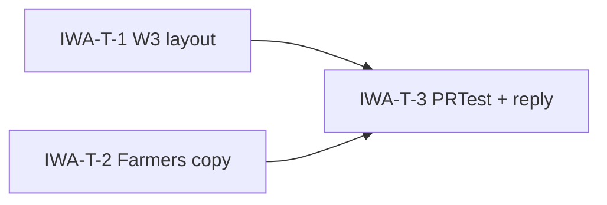

# Tasks — Innovation Use 2026: W3/Bilateral aligned with the pooled form

## 1. Scope of this task list

- **Module / feature:** W3 Innovation Use form (`type-innovation-use`) + shared Farmers copy
- **Linked spec:** `requirements.md` (IWA-R-1..R-5) + `design.md` (DD-1..DD-5, P-1..P-8)
- **Owner / driver:** Santiago Sánchez · Leader Claude
- **Status:** not-started (tasks approved 2026-11-26 by Santiago)
- **Branch:** `qa-development-2026-ss` (on top of IU26; deployed to PRTest together)
- **PR strategy:** one PR (~180 LOC). PR text states: "`/api/bilateral/*` payload unchanged" (AGENTS.md §6)

## 2. Pre-flight checklist

- [ ] Working tree: the unrelated `rir-breeding-exclusion` changes on the branch are not staged with this spec
- [ ] `cd onecgiar-pr-client && npx jest src/app/pages/bilateral/components/section-type-specific/type-innovation-use src/app/shared/components/innovation-use-form` green before starting (baseline)

## 3. Task list

### [x] IWA-T-1 — W3 2026 layout: Organizations in main block, no Addressing demands, pooled labels

- **Type:** client
- **Description:** In the W3 template, for 2026 results (`currentUseTotalLabels`) and TBD ≠ true, render the Organizations block in the main block, between Actors and Other quantitative measures, using one `ng-template` shared with the Full-metadata position. Full metadata keeps it only for non-2026. Hide "Addressing demands" in `actorCard` and `organizationCard` for 2026, without touching the model. Labels for 2026: "Add actor" and "Add organization"; 2025 keeps "Add another …". Keep everything inside the `[inert]="readOnly()"` wrapper. Update the folder `CLAUDE.md`: layout, plus DD-3's note on hidden values that count as "filled".
- **Implements:** IWA-R-1 (all 3 scenarios incl. BUT not in MDS, MUST not render twice), IWA-R-2 (scenario incl. BUT not null/"" and MUST still show on 2025), IWA-R-3, IWA-R-5
- **Design refs:** DD-1..DD-4, §8; P-1..P-4, P-7
- **Files:** `onecgiar-pr-client/src/app/pages/bilateral/components/section-type-specific/type-innovation-use/type-innovation-use.component.{html,ts,spec.ts}`, `…/type-innovation-use/CLAUDE.md`
- **Depends on:** — · **Blocks:** IWA-T-3
- **Estimate:** S
- **Review:** full — reason: moves an MDS-adjacent section on a form that centres submit; 2025 parity must be proven
- **Design route:** existing product UI, no new direction; reuse current W3 cards/tokens (`impeccable-bridge` not engaged beyond parity)
- **Skills:** `angular-developer`, `tdd`
- **Tests (new, in `type-innovation-use.component.spec.ts`, real template):**
  1. 2026, Full metadata collapsed, TBD false → DOM order of headers is `Actors` < `Organizations` < `Other quantitative measures`; exactly **one** "Organizations" header; expand Full metadata → still one.
  2. 2025 → no "Organizations" header while collapsed; one after expanding (today's behaviour).
  3. 2026 TBD = true → no "Organizations" header.
  4. 2026 → no "Addressing demands" label on actor or organization cards; 2025 → present.
  5. 2026 → actor with `addressing_demands: 'x'`, change `how_many`, flush save → scheduled payload `innovatonUse.actors[0].addressing_demands === 'x'` (same for an organization).
  6. 2026 → buttons "Add actor" / "Add organization" / "Add other"; 2025 → "Add another actor" / "Add another organization".
  7. `updateMds()` field list for 2026 equals the pre-change list (no organizations entry).
- **Verification:** `cd onecgiar-pr-client && npx jest src/app/pages/bilateral/components/section-type-specific/type-innovation-use` green · `npx ng build --configuration development` green (compile gate).
- **Falsifier:** revert the template change → tests 1, 4 and 6 fail. Wire Addressing demands with `[(ngModel)]` + a `null` fallback in `buildPayload` → test 5 fails. Render Organizations in both positions → test 1 "exactly one" fails. The tests need a fixture with at least one organization and one actor holding `addressing_demands`, otherwise tests 1/5 cannot tell the difference.
- **Red run (observed baseline, 990646d3e):**
  - `grep -n 'Add another actor\|label="Organizations"\|@if (showAllFields())\|label="Addressing demands"' type-innovation-use.component.html` → `136: Add another actor`, `210: @if (showAllFields())`, `213: label="Organizations"`, `525/594: label="Addressing demands"`. The only Organizations header sits inside the collapsed toggle, so test 1 will be red on the order and count assertion. The Implementer quotes the jest red on the behavioural assertion in `execution.md`.
- **Disqualifier:** a test that sets `showAllFields(true)` before asserting the 2026 order proves nothing about the main block. A test that builds its own HTML fragment instead of rendering the component template is not evidence. A red caused by a missing provider or a timeout is not a red.
- **Consumers:** none pin the changed labels or headers. `git grep -n "Add another actor\|Add another organization\|Addressing demands" -- '*.spec.ts' '*.cy.ts'` → 0 hits; `cypress/e2e/bilateral-type-specific-section.cy.ts` has no organization/addressing assertions (P-6). Re-run the grep after the change.
- **Not provable here:** spacing and look on the real page → IWA-T-3 human check.
- **Definition of done:** tests 1–7 green; red quoted; build green; `CLAUDE.md` updated; no server file touched (`git diff --stat` shows client only).

### [x] IWA-T-2 — Remove the two examples from the shared Farmers copy

- **Type:** client
- **Description:** In `FARMER_FOLLOW_UP_COPY`, remove `climate advisories; ` from the `information_received` description and `actively used a digital tool or service, ` from the `innovation_applied` description. The rest stays word for word. Update the two pinned expectations in the W1/W2 spec, and add an assertion that neither phrase appears. Update the folder `CLAUDE.md` note ("verbatim from mockup") with the amendment: INC-169264, Nicoleta, 2026-11-26.
- **Implements:** IWA-R-4 (scenario incl. "rest unchanged word for word" and MUST one place only)
- **Design refs:** DD-5, §9; P-5, P-8
- **Files:** `onecgiar-pr-client/src/app/shared/components/innovation-use-form/farmer-follow-up.ts`, `…/innovation-use-form.component.spec.ts:2027,2032`, `…/innovation-use-form/CLAUDE.md`
- **Depends on:** — (parallel with T-1) · **Blocks:** IWA-T-3
- **Estimate:** S
- **Review:** checklist — reason: copy-only edit in one constant; risk is limited to an exact-string match
- **Skills:** `angular-developer`
- **Expected text after:**
  - information_received: `Advisories delivered face-to-face, by SMS, radio/media or a digital platform; market information; dietary guidelines; starter kits, vouchers or other incentives. Receipt is documented; application of the innovation is not confirmed.`
  - innovation_applied: `Grew a variety, applied a practice, took up a product. Application is supported by the attached evidence (survey, plot observation, purchase records, platform logs).`
- **Verification:** `cd onecgiar-pr-client && npx jest src/app/shared/components/innovation-use-form src/app/pages/bilateral/components/section-type-specific/type-innovation-use` green. `git grep -n "climate advisories\|actively used a digital tool" -- onecgiar-pr-client onecgiar-pr-server ':!*.spec.ts' ':!*.md'` → 0 hits (amended 2026-11-26: the required "does not contain" assertion necessarily holds both phrases).
- **Falsifier:** put either phrase back → the new "does not contain" assertion fails. Delete an extra word (for example `market information; `) → the exact-equality expectation fails.
- **Red run (observed baseline, 990646d3e):** `git grep -n "climate advisories\|actively used a digital tool" -- onecgiar-pr-client onecgiar-pr-server` → 4 hits (`farmer-follow-up.ts:46,52`, `innovation-use-form.component.spec.ts:2027,2032`). The new "does not contain" assertion is red against the current constant; the Implementer quotes the jest red.
- **Disqualifier:** an assertion against a copy of the string written inside the test, rather than the imported constant, is a plumbing test and not evidence.
- **Consumers:** `innovation-use-form.component.spec.ts:2027,2032` (updated here). The W3 component reads the same constant (`type-innovation-use.component.ts:33,128`) and has no text assertion. The archive proposal is history and stays as is. The server holds labels only (`label-sources.ts:403`).
- **Definition of done:** grep 0 hits in code; specs green; red quoted; `CLAUDE.md` amended.

### [x] IWA-T-3 — PRTest check, ticket reply, IU26 link

- **Type:** rollout / docs
- **Description:** After merging into `performance-refactor` and deploying to PRTest, do a read-only browser check (never Save on test results):
  - W3 2026 (code 8427): Organizations shown between Actors and Other measures; no Addressing demands; "Add actor" / "Add organization" / "Add other"; the Organizations tile updates when a row is added locally.
  - W3 2025: unchanged.
  - W1/W2 2026 (code 6433): the Farmers nature options show the shortened descriptions. Record whether pooled showed the descriptions before (settles P-8 against Nicoleta's observation).
  - Spot check a 2026 W3 result's `/api/bilateral` response shape before and after (IWA-R-5).

  Then draft the reply to Nicoleta on SR-169264 and add a line in the IU26 `execution.md` pointing to this spec.
- **Implements:** IWA-R-1..R-5 (visual and acceptance), NFR defect class "visual look"
- **Depends on:** IWA-T-1, IWA-T-2
- **Estimate:** S
- **Review:** skip-eligible — reason: it must prove that no repo code changes (docs and a manual check only); the HITL pause with Santiago is the gate
- **Verification:** screenshots or notes in `execution.md` with result codes and phase; Santiago confirms at the HITL pause.
- **Falsifier:** checking on a stale deploy would show "Add another actor". The check records the deployed commit SHA, and it must match the merge commit.
- **Red run:** n/a — a manual acceptance check, not an automated gate.
- **Disqualifier:** a check done on localhost, or with Full metadata expanded, does not count for IWA-R-1.
- **Consumers:** none.
- **Definition of done:** checks recorded; reply drafted for Santiago to send; Nicoleta's acceptance pending outside the repo.

## 4. Dependency graph

## 5. Coverage (scenario/clause → task)

| Clause | Task / test |
|---|---|
| R-1 2026 order Actors→Organizations→Measures | T-1 test 1 |
| R-1 counts in "Organizations" tile | T-3 (tile wiring pre-exists, P-2) |
| R-1 BUT not in MDS / submit | T-1 test 7 |
| R-1 MUST not render twice | T-1 test 1 (count = 1 collapsed and expanded) |
| R-1 2025 scenario | T-1 test 2 |
| R-1 TBD scenario | T-1 test 3 |
| R-2 hidden | T-1 test 4 |
| R-2 payload keeps value · BUT not null/"" | T-1 test 5 |
| R-2 MUST show on 2025 | T-1 test 4 |
| R-3 labels 2026 / 2025 | T-1 test 6 |
| R-4 phrases gone (both screens) | T-2 assertion + grep; T-3 visual |
| R-4 rest word for word | T-2 exact-equality expectation |
| R-4 MUST one place only | T-2 grep 0 hits |
| R-5 bilateral unchanged | T-1 DoD (client-only diff) + T-3 API spot check |

## 6. Rollout & roll-back

- Rollout: together with IU26 to production after Nicoleta's acceptance.
- Roll-back: revert the single PR commit. No data or schema change.

## 7. Follow-ups

- None new. IU26 follow-ups (PDF NEW, bilateral `is_active` join bug) are unchanged.
