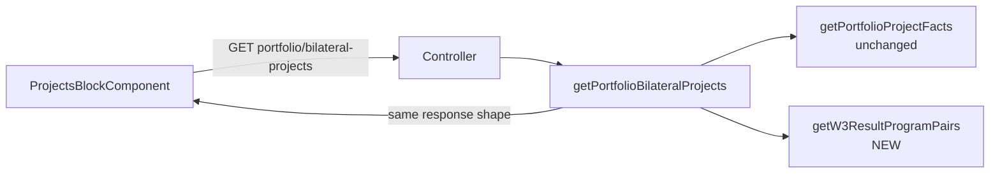

# Design — Portfolio Overview charts clarity (`POC`)

**Answer first:**
- **Server:** one new read-only repository query returns `(project, P/A code)` pairs for every P/A named on a W3 result of the version. The service uses those pairs only for `byProgram[].withBilateralResults`. Every other count, and the payload shape, stay as they are.
- **Client:**
  - the projects chart moves from one violet ramp to violet / orange / blue (W1/W2 keeps its stripes), and the KPI tiles get matching swatches;
  - two copy strings change (By Center note, By P/A caption);
  - the Typology key gets a guard test for the By Center tab.

## 1. Document Control

| Field | Value |
|---|---|
| Spec Path | `changes/portfolio-overview-charts-clarity` |
| Requirements | `requirements.md` (approved 2026-11-20, user "1") |
| Depth | Standard |
| Approval Mode | gated |
| Verified at | `b143445bd` |
| Status | approved (2026-11-20) |
| Date | 2026-11-20 |

## 1A. Premise Ledger

Count: 13 premises (10 verified, 3 `UNVERIFIED`: 1 High, 2 Low).
Blast-radius triggers:
- `live-path` fires: the user opens the page.
- `consumer` fires: the meaning of `withBilateralResults` changes, and so does the signature of the exported `buildProjectsOption`.
- `shared-state` does not fire: no shared service, base class or token util changes. `resolveChartTokens` stays as it is, and the copy keys that change have one reader each (P-9).

| # | Claim | Class | Citation (as run) | Verified at | If false | Settled by |
|---|---|---|---|---|---|---|
| P-1 | `byProgram[X].withBilateralResults` is incremented only through the project's approved mapping codes | location | `results-framework-reporting.service.ts:1167-1182` (`codes` from `row.approvedProgramCodes`, `addProject(counts, row.hasBilateral, …)`) | b143445bd | DD-1 targets the wrong place — High | — |
| P-2 | `getPortfolioProjectFacts` has one production caller | existence | `grep -rn "getPortfolioProjectFacts" --include=*.ts onecgiar-pr-server/src` → service `:1127`, its spec, the repo and its spec, one constant comment | b143445bd | A new column there would hit other callers. DD-1 already avoids it — Low | — |
| P-3 | A W3 contributor is written as `share_result_request` Draft (4) and becomes Pending (1) on approval. Accepting it creates an active `results_by_inititiative` role-2 row | data-env | `bilateral.service.ts:1699-1735`, `bilateral-center.service.ts:1867-1880` | b143445bd | The status set in DD-2 is wrong — High | — |
| P-4 | A **primary** request targets its P/A through `shared_inititiative_id`, with the same status ids (1 Pending, 2 Accepted, 3 Declined, 4 Draft) and `request_type = 'primary'` | data-env | `primary-program-request.service.ts:66-72, 346-347`; `share-result-request.entity.ts:21-24, 92-100` | b143445bd | A-1 cannot be read from that column — High | — |
| P-5 | Role 1 on `results_by_inititiative` is the result's primary P/A, written from `toc_mapping` | data-env | `bilateral.service.ts:1737` ("roleId === 1 (main toc) — full flow: results_by_initiative") | b143445bd | The primary branch of DD-2 is wrong — High | — |
| P-6 | The live path is: `/portfolio-overview` → `ProjectsBlockComponent` → `ResultsApiService.GET_PortfolioBilateralProjects` → `GET api/results-framework-reporting/portfolio/bilateral-projects` (Admin guard) → `getPortfolioBilateralProjects` → `getPortfolioProjectFacts` | live-path | `projects-block.component.ts:109` → `results-api.service.ts:1738-1739` → `results-framework-reporting.controller.ts:352-354, 372-386` → `service.ts:1104-1129` | b143445bd | The change misses the page — High | — |
| P-7 | Readers of `withBilateralResults`: client `projects-block.component.{ts,html}`, `projects.charts.ts`, `projects.format.ts`, `portfolio-bilateral-projects.interface.ts`; server DTO + service. Tests: `projects-block.component.spec.ts`, `projects.charts.spec.ts`, `projects.format.spec.ts`, `results-framework-reporting.service.spec.ts`. No Cypress hit | consumer | `grep -rn "withBilateralResults" --include=*.ts --include=*.html onecgiar-pr-client/src onecgiar-pr-server/src onecgiar-pr-client/cypress` + `--include=*.spec.ts --include=*.cy.ts` over both packages (node_modules excluded) | b143445bd | An unlisted reader would show the new meaning unexplained — Low | — |
| P-8 | `buildProjectsOption` has one production caller and one spec, and the spec pins the ramp colors | consumer | `grep -rn "buildProjectsOption" onecgiar-pr-client/src --include=*.ts` → `projects-block.component.ts:96`, `projects.charts.spec.ts:15,74`; spec `:24-26` expects `['c1','c3','c2']` | b143445bd | Another caller breaks on the new argument — Low | — |
| P-9 | `centerNote` is read only by the Typology block. `multiProgramCaption` only by the projects block | consumer | `grep -rn "centerNote\|typology-center-note"` → `typology-block.component.html:81`, its spec `:289,301`; `grep -n multiProgramCaption` → `projects-block.component.html:144`, spec `:157,207,218` | b143445bd | A copy change leaks into another block — Low | — |
| P-10 | The Typology key renders for both tabs (it sits inside `hlmTabsContent`), but the existing test checks the default tab only | existence | `typology-block.component.html:51-71`; `typology-block.component.spec.ts:181-189` (no tab switch) | b143445bd | POC-T-1 adds nothing — Low | — |
| P-11 | The chosen tokens exist with these hexes: `--pr-chart-1 #4a2bb8`, `--pr-color-orange-700 #c2410c`, `--pr-color-blue-500 #3b82f6`, `--pr-surface-card #ffffff` | data-env | `styles/colors.scss:299, 145, 124, 185` | b143445bd | DD-4 changes token — Low | — |
| P-12 | The new query runs on the server MySQL and returns in time comparable to the facts query | data-env | `UNVERIFIED — confirm at source before relying on it` (no `onecgiar-pr-server/.env` in this checkout: `ls onecgiar-pr-server/.env` → not found) | — | DD-2 needs a rewrite (e.g. a derived table without UNION) — High | Read-only `EXPLAIN` + run on staging at the POC-T-2 HITL check, owner: user |
| P-13 | The Center Overview (`/bilateral/:acronym/overview`) still attributes W3 projects per P/A by mapping, so the two screens differ after this change | other | `UNVERIFIED — confirm at source before relying on it` (from archived CPA requirements, Glossary "Mapped project (of a P/A)", a secondary source) | — | Follow-up note only — Low | Gap G-1, owner: user |
| P-14 | A-1 (a pending/draft primary choice names its P/A) matches what PMU expects | other | `UNVERIFIED — confirm at source before relying on it` — `user-stated` (consistency with the OQ-2 answer) | — | DD-2 drops the `primary` request branch — Low | User, at this design gate |

## 2. Architecture Overview

No new module or endpoint. The change sits on the existing path (P-6):

## 3. Data Model

No entity or migration. The new query reads `results_by_projects`, `result`, `results_by_inititiative`, `share_result_request` and `clarisa_initiatives`.

## 4. API Surface

`GET api/results-framework-reporting/portfolio/bilateral-projects`: same route, guard, query and response fields. Only two things change:
- the meaning of `byProgram[].withBilateralResults`;
- the Swagger `description` (`controller.ts:359`), which states the new rule (POC-R-6).

Not a `/api/bilateral/*` contract, so `bilateral-result-summaries.en.md` is not touched.

## 5. Server Workflow

**New repository method** `ClarisaProjectsRepository.getW3ResultProgramPairs(versionId)`: read-only, every value bound. It returns distinct `{ projectId, programCode }` pairs.

- **Result filter:** an active `results_by_projects` row and an active result with `source = API`, the requested version, and status not Discontinued. These are the same filters as `has_bilateral`, so the two cannot disagree.
- **Named P/A, branch (a):** an active `results_by_inititiative` row with role 1 or 2.
- **Named P/A, branch (b):** an active `share_result_request` toward `shared_inititiative_id`, with status in Pending/Draft and type in contribution/primary.
- **Combining:** the two branches are joined as a `UNION`, and each branch filters by version itself. The code comes from `clarisa_initiatives.official_code`, trimmed.

**Service** `getPortfolioBilateralProjects`:
1. Loads the facts (unchanged) and the pairs (new), in parallel.
2. Builds `projectId → Set<normalised code>` from the pairs.
3. For each fact row with ≥ 1 approved mapping code:
   - **totals:** unchanged (`addProject` with `hasBilateral` and `hasW1w2`);
   - **by mapped code:** `mapped` and `w1w2Contributors` only;
   - **by named code** (from the map, kept only when the code is in the seed): `withBilateralResults += 1`, once per code;
   - **by Center:** unchanged.
4. Rows with no approved mapping: unchanged (they go to `unmappedWithBilateralResults` only).

Errors: a pairs failure goes through the existing catch, which returns a generic 500 with no SQL. The page then shows the existing error state with Retry. There is no partial fallback, because a silent zero would be wrong data.

## 6. Frontend Plan

### 6.1 Components

| Component | Change |
|---|---|
| `projects-block/projects.charts.ts` | `buildProjectsOption(rows, tokens, labels, colours)`: a new `ProjectsSeriesColours` argument `{ mapped, withBilateral, w1w2 }`. Series read it instead of `tokens.ramp`. W1/W2 keeps `stripes` |
| `projects-block/projects-block.component.ts` | Exports a `PROJECT_SERIES_TOKEN` map (DD-4) and resolves it the way Typology does (`getComputedStyle`, falling back to the `var(--…)` string, never a literal hex) |
| `projects-block/projects-block.component.html` | Each KPI tile gets a small `aria-hidden` swatch with its series fill, and the W1/W2 swatch is striped (same CSS stripe recipe as the Typology key). `projects-multi-caption` text is replaced (DD-6) |
| `typology-block` | No code. A spec test for the key under the By Center tab (P-10) |
| `portfolio-overview.copy.ts` | `centerNote` (DD-5) and `projects.multiProgramCaption` (DD-6) |

### 6.2 Design system usage

Tokens only, as in Typology (`typology-block.component.ts:14-25`). No new token in `colors.scss`.

| Series | Token | Hex | Contrast vs `#ffffff` |
|---|---|---|---|
| Mapped | `--pr-chart-1` | `#4a2bb8` | 9.02 |
| With W3/Bilateral | `--pr-color-orange-700` | `#c2410c` | 5.18 |
| Contributing to W1/W2 (striped) | `--pr-color-blue-500` | `#3b82f6` | 3.68 |

CVD separation (Machado 2009 simulation, CIEDE2000, minimum pairwise): normal 28.6 · protan 24.3 · deutan 20.7 · tritan 27.6. All are ≥ 15, the POC-R-3 target. Computed with a node script over every 400–700 token in `colors.scss`. This triple scored best among mid-tone, non-red choices that keep the brand violet.

Page mode: product UI, existing dashboard (ENV per the parent revamp spec). No new screen. Direction: the existing Portfolio Overview language. `docs/ux-ui/design.md` §7 tokens apply.

## 7. Security

Admin guard unchanged. All values in the new SQL are bound, so no SQL text is interpolated. Errors keep the generic 500 body.

## 8. Performance

One extra query per page load, run in parallel with the facts query. Each `UNION` branch is restricted to the version. The cost is settled on staging (P-12).

## 9. Observability

The existing `this._logger.error` path logs failures with the error code only, never SQL or values.

## 10. Testing Plan

| Layer | Test |
|---|---|
| Repo (server Jest) | Pins the SQL clauses, statuses, types, roles, `is_active` on every table, the bind order and placeholder count, and the row mapping. The `getPortfolioProjectFacts` pins stay unchanged |
| Service (server Jest) | Fixtures for Scenarios 4.1–4.6 and 5.1. The shared mock gains `getW3ResultProgramPairs` (default `[]`). Existing WPS/POD assertions stay, except those on `byProgram[].withBilateralResults`, which are re-derived from a pairs fixture |
| Client Jest | Series colors from the colors argument; tile swatches; caption text from copy; By Center note text; key under the By Center tab |
| Palette Jest | Reads `styles/colors.scss`, resolves the three tokens, asserts different hue families, contrast ≥ 3 and simulated ΔE2000 ≥ 15 (pure helpers inside the spec) |
| HITL | Staging read-only query + visual look of the chart (light theme only: PRMS ships no dark mode, `docs/ux-ui/design.md:398`) |

## 11. Budget (Step 2.4)

| Expected | Value |
|---|---|
| Tasks | 5 |
| LOC | ~110 production + ~330 tests ≈ 440 |
| Review rounds | 6 (one per task, plus one margin for the SQL task) |

Tripwire: above 7 tasks, 600 LOC or 9 review rounds, stop and escalate.

## 12. Design Decisions

### POC-DD-1 — A separate pairs query, not a new column on the facts query
- **Decision:** add `getW3ResultProgramPairs`.
- **Why:** the facts query's spec pins 7 placeholders and 2 `status_id` mentions (`clarisa-projects.repository.spec.ts`, `:127` and `:133`). A `GROUP_CONCAT` over a correlated `UNION` would also need MySQL ≥ 8.0.14. A flat pairs query is simpler to test and to `EXPLAIN`.
- **Rejected:** a column on the facts query (above); computing it on the client (the client has no contributor data).
- **Backend route:** `nestjs-expert` (repository + service, project conventions). `api-design-principles`: same contract, meaning documented in Swagger.

### POC-DD-2 — "Named on the result" = role 1/2 rows ∪ Pending/Draft requests of either type
- **Decision:** count the user's OQ-2 answer ("every non-declined"), plus A-1 for primary requests (P-3, P-4, P-5).
- **Not counted:** Declined (3) never counts. Accepted (2) requests are not read, because acceptance already writes the role row. That also avoids counting an accepted request whose role row was later deactivated.

### POC-DD-3 — Only `byProgram[].withBilateralResults` changes
- **Decision:** totals, `mapped`, `w1w2Contributors`, `byCenter` and `unmappedWithBilateralResults` keep their rules (POC-R-5).
- **Why:** the ticket names only the per-P/A W3 count.
- **Consequence:** in the By P/A table, the W3 column can now sum to more than its Total row, and a P/A's W3 count can exceed its Mapped count. The caption says so (DD-6).

### POC-DD-4 — Violet / orange / blue palette with existing tokens
- **Decision:** see §6.2.
- **Why:** orange marks the block's subject (W3) and has the strongest contrast after violet. Blue plus stripes marks W1/W2.
- **Cross-block note:** Typology uses orange-700 for Policy change. The blocks have separate legends, and the projects chart has no result types, so this is accepted.
- **Rejected:** green-600 for W1/W2 (deutan ΔE 10.5, under target); orange-600 (protan ΔE 7.7).

### POC-DD-5 — By Center note text
- **Decision:** "Each result is counted once, under its lead Center (results with none are grouped as No lead Center). Filtering the page by Center also includes results where that Center only contributes; they still count under their lead Center."
- **Check:** two sentences, no "matches", covers POC-R-2 points 1–3.

### POC-DD-6 — One caption for the By P/A tab, replacing `multiProgramCaption`
- **Decision:** "A project counts under every P/A it is mapped to (Mapped, W1/W2) and under every P/A its W3/Bilateral results name as primary or contributing (W3/Bilateral). So the bars add up to more than the total, and a P/A's W3/Bilateral bar can be longer than its Mapped bar."
- **Why replace rather than add:** keeping the old sentence would state a rule (mapping only) that is no longer true for one column. The same `data-testid` and the same visibility (By P/A only, Chart and Table) are kept, so the existing spec assertions read `copy.*` and stay valid (P-9).

### Reversion challenge (Step 2.3) — dropping mapping-based W3 attribution (WPS behavior)

Question: what does removing it break?

| Possible breakage | Answer |
|---|---|
| "% of mapped" | Shown only on the totals tiles (`projects-block.component.html:60,65`), and totals are unchanged. Not broken |
| Chart clicks | The chart has no click handler (`grep chartClick` in projects-block → none). Not broken |
| Old caption | It would become false. Fixed by DD-6 |
| Center Overview (CPA) | Would now disagree with this page. Recorded as G-1, not fixed here (scope) |
| PMU's reported figure (57) | Could change. Release note in POC-T-3 |

## 13. Open Gaps & Follow-ups

| ID | Gap | Owner |
|---|---|---|
| G-1 | Align the Center Overview "Projects by P/A" W3 count with this rule (P-13) | User: new proposal if PMU wants parity |
| G-2 | POC-R-1 reaches prod only with the `staging → master` merge | Release owner |
| G-3 | POD (`bugfix/inc-168459-portfolio-overview-data`) must close or be merged before execute: same files | User |
