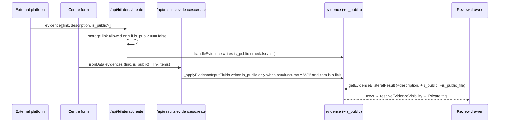

# Design — Bilateral evidence: public / private tag per piece of evidence

## Document Control

| Field | Value |
|---|---|
| Spec Path | `bilateral/evidence-privacy-tag` |
| Type / Deliverable / Depth | Change · software · Full |
| Approval Mode | gated |
| Ticket | P2-4110 |
| Requirements | `requirements.md` (approved by Santiago Sanchez, 2026-11-19, "Continue"). EVP-R-11 kept as "untagged on re-send". EVP-R-14 (Fetcher) added 2026-11-19 after the user's question, scoped here as one task with a separate PR (user: "Haz como mejor recomiendes") |
| Verified at | `cfc18d03e` (branch `qa-development-2026-ss`) · Fetcher repo `onecgiar_result_functions` at `314f3f2` |
| Status | approved (user, 2026-11-19, "sigue con phase 3"). Review Design not run |

## 1. Executive Summary

- **Storage:** one nullable column, `evidence.is_public`, holds the answer for **bilateral link items only**. File items keep their answer where it lives today (`evidence_sharepoint.is_public_file`).
- **Reads:** every reader computes **effective visibility** through one shared, pure resolver. A file follows `is_public_file`. A link follows `is_public`, and null means untagged, which reads as public.
- **Writes:** the bilateral API writer and the shared evidence endpoint (only for results with `source = 'API'`) write the column. Pool rows are never written.
- **Contract:** the storage-link refusal becomes conditional on `is_public === false`.
- **UI:** the review drawer gets the description and a Private tag. The centre form gets the question for links and the lock on link cards.

## 1A. Premise Ledger

**Count:** 19 premises · 17 verified · 2 `UNVERIFIED` (1 High: P-16 · 1 Low: P-17).
**Blast-radius triggers fired:** `live-path` (the design names user actions: centre save, API create, reviewer open), `shared-state` (the shared `evidence` entity and the shared create endpoint), `consumer` (a stored field and response shapes change).

| # | Claim | Class | Citation (as run) | Verified at | If false | Settled by |
|---|---|---|---|---|---|---|
| P-1 | File visibility lives only in `evidence_sharepoint.is_public_file`. `evidence` has no visibility column | existence | `onecgiar-pr-server/src/api/results/evidences/entities/evidence-sharepoint.entity.ts:46-51`; `grep -n "Column\|name:" .../evidence.entity.ts` lists no visibility column | `cfc18d03e` | DD-1 changes: reuse an existing column instead of adding one. **High** | — |
| P-2 | Live path, centre save: `section-evidence.component.ts:446-453` builds `jsonData` → `bilateral-api.service.ts:225-226` `POST …/evidences/create/:id` → `evidences.controller.ts:27-40` → `EvidencesService.create` (`evidences.service.ts:95`) → `_processMainEvidencesOnCreate` (`:257`) → `_upsertEvidenceItemV1` (`:218`) → `_applyEvidenceInputFields` (`:131-151`) → save. Branch point: `is_sharepoint` → `saveSPData` (`:567`) | live-path | file:line chain as listed | `cfc18d03e` | DD-3 targets the wrong writer, and EVP-T-3 moves. **High** | — |
| P-3 | Pool W1/W2 saves use the **same** endpoint | shared-state | `onecgiar-pr-client/src/app/shared/services/api/results-api.service.ts:401` (`evidences/create/${currentResultId}`) | `cfc18d03e` | The pool guard in DD-3 would be unnecessary. **Low** | — |
| P-4 | Bilateral results carry `source = 'API'` (`SourceEnum.Bilateral`), set by the centre-form create, the API create and the KP handler | data-env | `api/results/entities/result.entity.ts:51-54`; `api/bilateral/services/bilateral-center.service.ts:180, 564`; `api/bilateral/bilateral.service.ts:4553`; `api/bilateral/handlers/knowledge-product.handler.ts:66` | `cfc18d03e` | The DD-3 guard leaks into pool or misses bilateral rows. **High** | — |
| P-5 | `_upsertEvidenceItemV1` receives the `result` row, so the guard needs no extra query | location | `evidences.service.ts:218-223` signature `(result, evidence, user, evidenceTypeId)` | `cfc18d03e` | EVP-T-3 adds a lookup. **Low** | — |
| P-6 | Live path, API create: `bilateral.controller.ts:49-64` → `BilateralService.create` → `handleEvidence` (`bilateral.service.ts:6259-6302`), which is the only bilateral evidence writer. Resubmission deactivates evidence (`bilateral-resubmission.service.ts:995-997`) and rewrites it through that same writer (`:918-919`) | live-path | file:line as listed; `grep -n "handleEvidence(" bilateral.service.ts` → call sites `:672`, `:5060` | `cfc18d03e` | EVP-R-11 needs another writer. **High** | — |
| P-7 | `EvidenceDto.link` refuses storage links through `@IsNotCloudStorageLink()`, which is the only user of that decorator | existence | `api/bilateral/dto/create-bilateral.dto.ts:943-963`; `grep -rn "IsNotCloudStorageLink" src --include=*.ts \| grep -v spec` → 1 decorator use (`create-bilateral.dto.ts:954`) | `cfc18d03e` | DD-4 must keep the old decorator for other callers. **Low** | — |
| P-8 | All bilateral reads (`findOne`, `findAll`, `listAllResults`, `getResultsForSync`, create response) project evidence through `buildResultRelations` + `filterActiveRelations` | shared-state | `bilateral.service.ts:463-466, 743-746, 953-960, 984-986, 1170-1172, 1266-1268, 1294-1327, 2122-2152` | `cfc18d03e` | DD-5 needs per-endpoint edits. **High** | — |
| P-9 | No PRMS server code emits the doc's slim `evidences[]` key. It is emitted by the Fetcher (P-19) | existence | `grep -rn "evidences\s*:" api/bilateral api/platform-report api/results-framework-reporting --include=*.ts` → 0 non-spec hits. Alternate names `evidence_array`/`evidences` checked | `cfc18d03e` | A slim mapper in PRMS also needs the field. **Low** | — |
| P-10 | The review detail reads evidence via SQL `SELECT e.id, e.link, e.is_sharepoint`, with no description and no visibility | location | `api/results/result.repository.ts:3933-3946`, called from `results.service.ts:4188-4192` (`getBilateralResultById`, route `results.controller.ts:970/986`) | `cfc18d03e` | DD-6 edits a different query. **High** | — |
| P-11 | The drawer renders `fields.evidence[]` as bare URL anchors | location | `result-review-drawer.component.html:598-611` | `cfc18d03e` | EVP-T-9 targets another template. **High** | — |
| P-12 | The review drawer's evidence save (`updateEvidencesPartial`) keeps rows with an `id` and only creates rows without one, so an existing item's column survives a drawer save | shared-state | `evidences.service.ts:941-955` (find existing → deactivate missing → `_createNewEvidences` only for `!id`, `:1000-1010`) | `cfc18d03e` | A drawer save would wipe tags and needs a guard. **High** | — |
| P-13 | The centre form load uses `GET …/evidences/get/:id` → `getEvidencesByResultId`, whose SQL lists columns explicitly, so a new column is invisible until it is added there | location | `bilateral-api.service.ts:221-222`; `evidences.repository.ts:420-450` | `cfc18d03e` | The form can't show link locks. **High** | — |
| P-14 | AI-draft promotion creates only **file** items (`is_sharepoint = 1`, `is_public_file = false`), and change-type does not touch evidence | shared-state | `api/bilateral-ai/services/bilateral-ai-evidence-transfer.service.ts:140-163`; `awk` over `bilateral-center.service.ts` from `:718` (`changeResultType`) to its closing brace for `[Ee]vidence` → 0 hits | `cfc18d03e` | EVP-R-11 needs tasks for those paths. **Low** | — |
| P-15 | **Consumers** of the changed contracts (`evidence` row, bilateral responses, review detail, AI payload). Command: `grep -rn "is_public_file\|evidence_array\|getEvidenceBilateralResult\|mapEvidence(" onecgiar-pr-server/src onecgiar-pr-client/src --include=*.ts --include=*.html` plus the `-l` sweep in the proposal session. Readers: `evidence.mapper.ts:52-79` (AI quality); `results.service.ts:3640-3712` `getAIContext` (route `v2 …/results/ai/context`, client `ai-review.service.ts:193`); `section-evidence.component.*`; `result-review-drawer.component.*`; `ipsr-step3-evidence-list.*` and `evidence-item.component.html` (pool, which must stay unchanged); `bilateral-quality-payload.builder.spec.ts`; `evidences.service{,.confidentiality,.p2-3601,.p2-3692}.spec.ts` + `versioning.service.spec.ts` (all pin `getEvidencesByResultId`; full sweep in `tasks.md` EVP-T-3); `qa-catalog/definitions/sections/evidence.ts`, and the **QAC-R-7 completeness guard** `qa-catalog.completeness.spec.ts` (fails on any uncatalogued own column of `evidence`; exemptions in `qa-catalog/definitions/not-for-qa.ts:267-284`), which requires a `not-for-qa.ts` entry for `is_public` (EVP-T-1) | consumer | command as listed | `cfc18d03e` | A missed reader shows a private link as public. **High** | — |
| P-16 | Readers **outside this repo** (Results Dashboard, platform report) read evidence from the DB or the bilateral API and could publish a private link | consumer | `UNVERIFIED — confirm at source before relying on it` | — | EVP-RISK-1 becomes a blocking item for release. **High** | PO/BA (Santiago Sanchez to raise with the Results Dashboard owner) at the `/akili-validate` HITL pause |
| P-18 | Live path, Fetcher ingest: AJV with `removeAdditional: true` (`services/fetcher/src/validator/ajv.js:6`) validates `evidence[]` items against a schema with only `link`/`description` and `additionalProperties: false` (`services/fetcher/src/validator/schemas/common_fields.json:334-346`). An `is_public` sent through the Fetcher is therefore deleted before it reaches `POST /api/bilateral/create`. The Fetcher has no storage-link check: `grep -rn -i "sharepoint\|drive.google\|cloud" services/fetcher/src/validator services/fetcher/src/normalizer.mjs services/fetcher/src/mappers` → 0 hits | consumer | file:line and command as listed, repo `onecgiar_result_functions` | `314f3f2` | EVP-T-10 unnecessary; ACs 2/3 already hold via the Fetcher. **High** | — |
| P-19 | Fetcher output: `EvidencesMapper` (`services/fetcher/src/mappers/response-result.mjs:428-443`), fed from PRMS `evidence_array` at `:690`, copies only `link`/`description`. The normalizer and the sync service do not touch evidence: `grep -ci evidence services/fetcher/src/normalizer.mjs` → 0; `grep -rn -i evidence services/sync/src` → 0. Doc consumers: `services/fetcher/src/docs/openapi.json` (evidence examples; `evidences` schema at `:2321`), pinned by `services/fetcher/test/openapi-docs.test.mjs`; `services/api-docs/app/lib/types.ts:89` | consumer | file:line and command as listed | `314f3f2` | Fetcher output already carries the tag. **High** | — |
| P-17 | MySQL accepts `ADD COLUMN … TINYINT NULL` on `evidence` online within the deploy window (table size) | data-env | `UNVERIFIED — confirm at source before relying on it` | — | The migration needs an off-hours window. **Low** | EVP-T-1, first step: row count on TEST |

## 2. Architecture Overview

### 2.1 Where this lives

| Layer | Component | Change |
|---|---|---|
| DB | `evidence` | + `is_public` TINYINT NULL |
| Server, shared | `results/evidences` (entity, repository `getEvidencesByResultId`, service `_applyEvidenceInputFields`) | column, select, guarded write |
| Server, shared util | new pure resolver `resolveEvidenceVisibility` beside `results/evidences` | single derivation rule |
| Server, bilateral | `create-bilateral.dto.ts` (`EvidenceDto`), `bilateral.service.ts` (`handleEvidence`, `filterActiveRelations`), `shared/validators/is-not-cloud-storage-link.validator.ts` | API in/out, conditional storage rule |
| Server, review | `result.repository.ts` `getEvidenceBilateralResult`, `results.service.ts` `getBilateralResultById`, `getAIContext` | description + visibility |
| Server, AI | `quality-assessment/mappers/evidence.mapper.ts` | link visibility honoured |
| Client | `section-evidence.component.*` (centre form), `result-review-drawer.component.*` | question, lock, tag, description |
| Docs | `bilateral-result-summaries.en.md` | contract + change log |
| Fetcher (repo `onecgiar_result_functions`) | `services/fetcher/src/validator/schemas/common_fields.json` (evidence item), `mappers/response-result.mjs` (`EvidencesMapper`), `docs/openapi.json`, `services/api-docs/app/lib/types.ts` | accept + forward `is_public`, return it (EVP-R-14) |

### 2.2 Flows

## 3. Data Model

### 3.1 Entity

| Entity | Path | Change |
|---|---|---|
| `Evidence` | `api/results/evidences/entities/evidence.entity.ts` | + `is_public`: TINYINT, **nullable, no default**. Meaning: the bilateral link item's answer. `1` = public, `0` = private, `NULL` = untagged. Never written for pool rows or file items |
| `EvidenceSharepoint` | unchanged | `is_public_file` stays the file answer and the SharePoint permission source |

**Visibility resolver (one rule, every reader):**

| Item | `is_public` | `is_public_file` | Effective visibility | Exposed `is_public` value |
|---|---|---|---|---|
| link | 1 | — | public | `true` |
| link | 0 | — | **private** | `false` |
| link | NULL | — | public (untagged) | `null` |
| file | ignored | 1 | public | `true` |
| file | ignored | 0 or NULL | **private** | `false` |
| file, no SP row (legacy anomaly) | ignored | absent | private | `false` |

The last row matches today's AI-mapper reading (`!!sharepointRow?.is_public_file`, `evidence.mapper.ts:57-63`), so no reader changes its meaning for files.

### 3.2 Migration

- **Name:** `<timestamp>-EVP-AddEvidenceIsPublic.ts`, timestamp after `1793400000000`, header `// @akili-spec bilateral/evidence-privacy-tag`.
- **`up`:** add the column if it is absent (idempotent).
- **`down`:** drop it.
- **The four futures (repo rule, same as `1793400000000-RCF-CenterRouting.ts:17-22`):**
  - Applied without the code: the column is unread. Inert.
  - Code without the migration: not a normal path, because Jenkins applies migrations first.
  - Applied twice: guarded, so a no-op.
  - Reverted: the column is dropped and tags are lost. Effective visibility falls back to public for links, which is today's behaviour.
- No backfill.

## 4. API Design

### 4.1 `POST /api/bilateral/create` (and the upsert/resubmission via the same DTO)

| Field | Value |
|---|---|
| Change | `EvidenceDto` + `is_public?: boolean \| null` (optional, `@IsOptional() @IsBoolean()`). Swagger text: "Whether this evidence can be shared publicly. `false` marks it private; omitted or null = not stated, treated as public." |
| `link` rule | `@IsUrl({require_protocol})` and `@IsNotEmpty` unchanged. The storage-link refusal applies **unless** `is_public === false` on the same item (DD-4). Message unchanged |
| Errors | 400 for non-boolean `is_public` (class-validator default shape, property `is_public`). 400 for a storage link with `is_public` true, absent or null (today's message). Both before the first write (today's ordering, P-6) |
| Response | Unchanged envelope. Each `evidence_array[]` row carries `is_public` (DD-5) |

### 4.2 Bilateral reads (`GET /api/bilateral`, `/list`, `/results`, `/:id`)

Each `evidence_array[]` row's `is_public` is overwritten in `filterActiveRelations` with the resolver's **exposed value** (§3.1). Links therefore show `true/false/null` and files show `true/false`. This is additive: no key removed, and `evidenceSharepointArray` is untouched.

### 4.3 Review detail `GET /api/results/bilateral/:resultId`

`evidence[]` items gain `description` (string or null) and `is_public` (resolver exposed value). They still carry `id`, `link` and `is_sharepoint`. One query: `LEFT JOIN` to the single **active** SP row per evidence, aggregated so an evidence row never duplicates (DD-6).

### 4.4 Shared `POST /api/results/evidences/create/:resultId`

The request interface `EvidencesCreateInterface` (`create-evidence.dto.ts:7-29`) gains an optional `is_public`. It is read **only** when the result is bilateral and the item is a link (DD-3). `GET …/evidences/get/:id` rows gain `is_public` (the raw column) for the centre form.

### 4.5 AI surfaces

| Surface | Change |
|---|---|
| Quality payload (`mapEvidence`) | `visibility` from the resolver: private ⇒ `link: null` (EVP-R-10). Public and untagged links unchanged |
| `getAIContext` | Each item gains `is_public` (resolver exposed value) beside its existing `is_public_file`. **Bilateral results:** a private item (link or file) is sent with `link: null`; the description and flags are kept. **Pool results:** links are unchanged (DD-8, amended 2026-11-20) |

### 4.6 Fetcher (`onecgiar_result_functions`, separate PR)

| Field | Value |
|---|---|
| Ingest | The `evidence` item schema declares `is_public` as type `["boolean","null"]`, not required. `additionalProperties: false` stays: only the one key is opened |
| Output | `EvidencesMapper` adds `is_public` from the PRMS row, with `null` when absent (PRMS resolver value per §4.2) |
| Docs | `openapi.json` evidence examples and the `evidences` schema gain `is_public`. `api-docs` `types.ts` too |
| Deploy order | **PRMS server PR first, then the Fetcher PR.** If the Fetcher ships first, PRMS's `whitelist: true, forbidNonWhitelisted: false` (`onecgiar-pr-server/src/api/bilateral/bilateral.controller.ts:54-57`) drops the unknown key, so the item is stored untagged and nothing breaks (D13) |
| Precedent | `keep_editing` was declared in both places the same way (`bilateral-result-summaries.en.md:778`; `services/fetcher/test/keep-editing.test.mjs`) |

## 5. Backend Module Design

| Unit | Responsibility | Backend lead (from `backend-routing.md`) |
|---|---|---|
| Resolver (pure function) | Effective visibility + exposed value from a row (`is_sharepoint`, `is_public`, first SP row). No I/O | implement: `nestjs-expert` |
| `handleEvidence` | Persist `is_public` from the DTO (`?? null`) | implement: `nestjs-expert` |
| `_applyEvidenceInputFields` | Write `is_public` only when `result.source === API` and the item is not SharePoint. Otherwise leave the property untouched. Bilateral file items are set to null | implement: `nestjs-expert`; architecture not significant → existing design |
| Storage-link validator | A conditional variant reading the sibling `is_public` on the validated object. The original decorator keeps its exact behaviour | api-contract: `api-design-principles` |
| `filterActiveRelations`, `getBilateralResultById`, `getAIContext`, `mapEvidence` | Call the resolver | implement: `nestjs-expert` |

## 6. Frontend / UX Component Architecture

### 6.1 Screens

| Screen | Page mode | Env class (evidence) | Direction |
|---|---|---|---|
| Centre form, Evidence section + Add/Edit modal (`pages/bilateral/components/section-evidence/`) | Operate | ENV-2: `docs/ux-ui/design.md` §7 defines tokens; the Impeccable skill source is `user-installed` (`~/.claude/skills/impeccable`) | Extend the existing pattern: the same radio and lock already used for files. No new visual language |
| SP review drawer, card 3 "Collaboration & Evidence" (`result-framework-reporting/pages/bilateral-review/components/result-review-drawer/`) | Operate | ENV-2 (same evidence) | Extend the existing row. A pill styled like the drawer's existing "Center-reported (Read-only)" pill (`result-review-drawer.component.html:442-446`) |

### 6.2 Centre form changes (EVP-R-2/3/4)

- The public question renders for **both** sources. Link mode stops clearing the answer silently: switching the source still clears it (scenario "Switching source").
- `isDraftValid` for links requires an answer.
- `draftLinkError`: a storage link is an error **unless** the answer is No.
- `hasValidLink`: a private storage link counts as valid.
- Body mapping: link items send `is_public` = the draft answer. File items keep sending `is_public_file` as today.
- Load mapping: a link row's `is_public` maps into the draft model's existing `is_public_file` slot, so one UI binding serves both. Null stays null.
- Card lock: shown for links when the answer is non-null. Hidden for untagged links.
- Copy for the No-answer note on links: *"Private: the Science Program reviewing this result will see it marked as private. PRMS does not change who can open the link."*

### 6.3 Review drawer changes (EVP-R-7/8/9)

- Each row:
  - **Line 1:** the link icon, the URL anchor (unchanged: `href`, `target=_blank`, `rel`), then the Private pill when the effective visibility is private.
  - **Line 2:** the description, when it is present and non-blank.
- Pill:
  - lock icon plus the text "Private", built from design tokens (no raw hex);
  - the tooltip (`prTooltip`, as used in `ipsr-step3-evidence-list.component.html:77`) carries the EVP-R-9 text;
  - an `aria-label` that includes the text.
- `data-testid` hooks: `evidence-private-tag`, `evidence-description`.
- The admin "Add Evidence Link" input is unchanged (OQ-3). Added rows have no `is_public`, so they are untagged.

## 7. Shared Contracts

- The contract doc `bilateral-result-summaries.en.md` gets:
  - in the core-fields table (`:109-113`), the evidence row describes `is_public`;
  - a dated change-log entry: P2-4110, additive, the storage-link exception partially reversing the 2026-08-26 entry, and the rewrite rule (EVP-R-11);
  - a correction of the stale slim `evidences[]` wording (P-9) to `evidence_array[]`.

## 8. Security, Privacy, Observability

- No access control is added (EVP-R-7).
- Pre-existing log: `_processMainEvidencesOnCreate` logs the evidence **link** on a save failure (`evidences.service.ts:312`). This change adds no log line. Changing that log line is out of scope and recorded in §11 as a follow-up.
- Validation errors keep the existing shapes.

## 9. Design Decisions

### EVP-DD-1 — Nullable column for link items; files keep `is_public_file`
- **Decision:** proposal Option A, refined. The column is written for bilateral link items only. Files derive from `is_public_file`.
- **Rejected:**
  - Mirroring file answers into the column: two writers for one fact, and legacy files have no mirror.
  - A single column for all flows: touches pool (AC 10).
- **Premises:** P-1, P-14.

### EVP-DD-2 — One pure resolver, every reader
- **Decision:** each reader calls the same function. This puts the derivation rule in one place, so the readers (P-15) cannot drift.

### EVP-DD-3 — Pool guard on the shared writer keyed on `result.source`
- **Decision:** guard on `result.source === 'API'`, not on "the client sent the field". A pool client that ever sent `is_public` still writes nothing (AC 10 holds on the server, not by client discipline).
- **Premises:** P-2, P-3, P-4, P-5.

### EVP-DD-4 — Conditional storage-link refusal *(reversion: yes)*
- **Decision:** refuse unless `is_public === false`. `null`/absent keep the refusal (EVP-R-4).
- **Reversion challenge — "what does removing this break?"** The 2026-08-26 refusal existed because a storage link can't be rendered or reviewed from outside the tenant (`bilateral-result-summaries.en.md:790`). Breakage candidates:
  1. **The Results Dashboard renders a dead private link.** Accepted per the ticket ("PRMS does not block access"); tracked by P-16.
  2. **The AI fetches a tenant link.** Addressed: private ⇒ `link: null` in the quality payload (EVP-R-10).
  3. **The existing test `evidence.dto.spec.ts` "rejects the file storage link"** stays true, because its fixtures send no `is_public`. It gains the private case. Nothing else breaks. The challenge leaves the design unchanged.

### EVP-DD-5 — Expose the resolver value under the column's own name in bilateral reads
- **Decision:** consumers read a single `is_public` per item, whether link or file.
- **Rejected:**
  - A new `visibility` enum key: it duplicates the column name the input uses.
  - Raw column values: files would read `null` and look untagged.

### EVP-DD-6 — Review detail: extend the SQL, one row per evidence
- **Decision:** add `description`, `is_public`, and an aggregated active `is_public_file`. The no-N+1 NFR is held.

### EVP-DD-7 — Centre form reuses the `is_public_file` UI slot
- **Decision:** one radio, one lock binding. Only the wire mapping differs by item kind (§6.2).

### EVP-DD-8 — `getAIContext` gets the flag, and withholds bilateral private links
- **Decision (amended 2026-11-20 at `/akili-validate`, user decision):** items carry `is_public`. On a **bilateral** result (`source = 'API'`), a private item (link or file) is sent with `link: null` and keeps its description, which satisfies NFR Security on this second AI surface. On a **pool** result, links are sent exactly as before (EVP-R-12).
- *Original decision (superseded):* no withholding, because that surface already sent private file links.

### EVP-DD-9 — Rewrite is payload-truth (EVP-R-11)
- **Decision:** a re-send without `is_public` stores untagged, and the contract doc says so. Approved at the Phase 1 gate (user, 2026-11-19).

## 10. Testing Plan (forward-looking)

| Defect class | Test home |
|---|---|
| D1/D2/D3 | `evidence.dto.spec.ts` (extend), `bilateral.service.spec.ts` (`handleEvidence`, `filterActiveRelations`) |
| D3 client | `section-evidence.component.spec.ts` |
| D4 | `bilateral-quality-payload.builder.spec.ts` / new mapper cases |
| D5 | new `evidences.service.evp.spec.ts` (pool source writes nothing; API source writes) + existing pool suites |
| D6 | `npm run migration:check:ci` |
| D7 | `result-review-drawer.component.spec.ts` |
| D8 | server `npx tsc --noEmit -p tsconfig.json`; client `npx ng build --configuration development` |
| D9 | HITL visual at `/akili-validate` |
| D10 | resubmission spec through `handleEvidence` |
| D12 | new `services/fetcher/test/evidence-is-public.test.mjs` (`npm test` in `services/fetcher`) + `openapi-docs.test.mjs` |
| Resolver | new unit spec over every §3.1 table row |

## 11. Budget (tripwire for `/akili-execute`)

| Measure | Expected |
|---|---|
| Tasks | 11 (the contract doc and the Fetcher are separate tasks: EVP-T-10, EVP-T-11) |
| LOC | ~780: server prod ~190, client prod ~130, Fetcher ~20, tests ~400, docs ~40 |
| Review rounds | ~15: 1 per task + 1 extra each on EVP-T-4 (validator), EVP-T-8 (form) and EVP-T-9 (drawer); +1 margin |

Depth check: Full holds. A Standard cut is possible but would drop rollout/rollback detail on a regulated external contract.

## 12. Open Gaps & Follow-ups

- P-16 (Results Dashboard): settled at the validate HITL with the PO/BA.
- Follow-up ticket candidate: stop logging evidence links in `_processMainEvidencesOnCreate` failure messages.
- Follow-up ticket candidate: admin-added drawer links asking the question (OQ-3).
