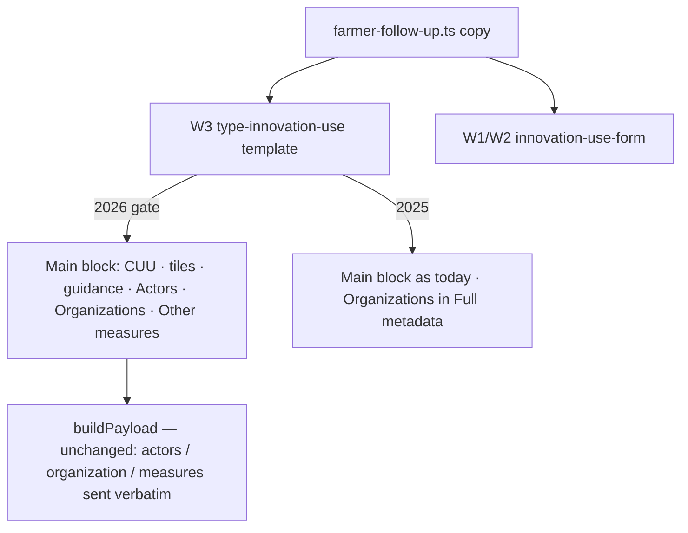

# Design — Innovation Use 2026: W3/Bilateral aligned with the pooled form

## 1. Document Control

| Field | Value |
|---|---|
| Spec path | `changes/innovation-use-2026-w3-pooled-alignment` |
| Depth | Lite |
| Status | approved 2026-11-26 (Santiago — Phase 2 Continue) |
| Verified at | `990646d3e` (branch `qa-development-2026-ss`) |
| Requirements | `requirements.md` IWA-R-1..R-5 |
| Visual source | Nicoleta's annotated screenshots (ticket p.5); target = existing W1/W2 form |

## 2. Executive Summary

Template-only change in the W3 component, behind the existing 2026 gate (`currentUseTotalLabels`), plus one shared copy edit. No server, schema, API or MDS change.

## 3. Architecture Overview

## 4. Extended Directory Structure

| File | Change |
|---|---|
| `onecgiar-pr-client/src/app/pages/bilateral/components/section-type-specific/type-innovation-use/type-innovation-use.component.html` | Organizations block also rendered in the main block for 2026; Addressing demands gated; button labels gated |
| `…/type-innovation-use/type-innovation-use.component.ts` | No logic change expected (gate already exists); maybe one getter for labels |
| `…/type-innovation-use/type-innovation-use.component.spec.ts` | New specs IWA |
| `…/type-innovation-use/CLAUDE.md` | Layout note |
| `onecgiar-pr-client/src/app/shared/components/innovation-use-form/farmer-follow-up.ts` | Two phrases removed |
| `…/innovation-use-form/innovation-use-form.component.spec.ts:2027,2032` | Expected copy updated |

## 5–7. Data Model · API · Backend

None. `/api/bilateral/*`, `results/summary` and the DB are untouched (IWA-R-5).

## 8. Frontend / UX Component Architecture

Page mode: existing form, product UI (ENV per `docs/ux-ui/design.md`; no new surface, no direction work — reuse current W3 tokens and cards).

| Section (2026 W3, main block, TBD ≠ true) | Source |
|---|---|
| CUU · tiles · guidance | IU26, unchanged |
| Actors · button **"Add actor"** | existing `actorCard` |
| **Organizations** (optional, header "Organizations") · button **"Add organization"** | existing `organizationCard`, moved |
| Other quantitative measures · button "Add other" | unchanged |
| Full metadata | everything it holds today **minus Organizations** |

States: empty → existing `app-no-data-text "No organizations added"`; TBD = true → Organizations hidden with Actors and measures; read-only → covered by the existing `[inert]="readOnly()"` wrapper (must stay inside it).

## 9. Shared Contracts

`FARMER_FOLLOW_UP_COPY.useNatureOptions[*].description` loses "climate advisories; " and "actively used a digital tool or service, ". Codes and labels unchanged → QA catalog (labels only) unaffected.

## 10. Design Decisions

| ID | Decision | Req | Why / rejected |
|---|---|---|---|
| DD-1 | Render the Organizations block in the main block when `currentUseTotalLabels` (2026) and TBD ≠ true; inside Full metadata only when not 2026 | R-1 | One template block reused via `ng-template`, so one card definition. Rejected: duplicating markup; always moving (breaks 2025 parity) |
| DD-2 | Organizations stays out of `updateMds()` and the submit gate | R-1, OQ-2 | Pooled parity; API MDS unchanged |
| DD-3 | Hide "Addressing demands" in `actorCard` and `organizationCard` when 2026. The model value is not touched; `buildPayload` already sends rows verbatim (P-3) | R-2 | **Reversion** → challenged below |
| DD-4 | Button labels via the 2026 gate: "Add actor" / "Add organization"; 2025 keeps "Add another …" | R-3 | 2025 parity (IU26 test step 3) |
| DD-5 | Edit the shared constant; both forms follow | R-4 | One source of truth (P-5). Rejected: a W3-only copy (would create the divergence Nicoleta complains about) |

### Reversion challenge (Step 2.3) — "what does removing this break?"

- **DD-3 (hide Addressing demands):** the value stays in `body.actors` and goes back on save (P-3). The "row has figures" check (`type-innovation-use.component.ts:248`) still counts `addressing_demands`, so a hidden value can mark a row as filled. Effect: only a row with a hidden value and **no actor type** would get the "row has figures but no actor type" error. API rows always carry a type, so the impact is Low. We accept it and record it in `CLAUDE.md`; no design change.
- **DD-5 (remove phrases):** 2 assertions in the W1/W2 spec pin the old text (P-6) and are updated in the same task. No server or report reads the description (P-5).

## 11. Premise Ledger

Count: 8 verified · 0 UNVERIFIED.
Blast-radius triggers fired:
- `live-path` — the user action is opening a 2026 W3 result.
- `shared-state` — the 2026 gate and the TBD flag are read by several blocks.
- `consumer` — the shared copy constant and the button/label DOM text change.

| # | Claim | Class | Citation (as run) | Verified at | If false | Settled by |
|---|---|---|---|---|---|---|
| P-1 | Organizations are rendered only inside `@if (showAllFields())`; the toggle defaults to false | location | `type-innovation-use.component.html:210-227`; `.ts:196` `signal(false)` | 990646d3e | No layout change needed (High) | — |
| P-2 | W3 totals already include organizations | existence | `type-innovation-use.component.ts:337-340` → `totalsByCategory(actors, this.body.organization, measures)` | 990646d3e | T-1 must add totals wiring (Low) | — |
| P-3 | Save sends actors and organizations verbatim (only `institution_sub_type_id` remapped), so a hidden `addressing_demands` is preserved | live-path | `type-innovation-use.component.ts:898-913` (`buildOrganizationsForSave`, `buildPayload` → `innovatonUse.actors: this.body.actors`) via `schedulePayload` `:874` | 990646d3e | DD-3 needs payload work (High) | — |
| P-4 | The 2026 gate is `currentUseTotalLabels` = phase year ≥ `CURRENT_USE_UPDATE_MIN_PHASE_YEAR`. Main block sections read the TBD flag at `.html:79` (actors) and `:143` (measures) | shared-state | `type-innovation-use.component.ts:304-310`; `.html:79,143`; other readers of the gate: tiles `.ts:344`, guidance `.html:114`, quantity label `.html:157` | 990646d3e | DD-1/DD-4 need a new gate (Low) | — |
| P-5 | The Farmers descriptions exist in one place. The server holds only labels | consumer | `git grep -n "climate advisories\|actively used a digital tool" -- . ':!docs/specs/changes/innovation-use-2026-w3-pooled-alignment'` → `farmer-follow-up.ts:46,52`, `innovation-use-form.component.spec.ts:2027,2032`, archive proposal `:88-89` (history, kept); `onecgiar-pr-server/src/api/qa-catalog/values/label-sources.ts:403` label only | 990646d3e | Server/catalog edit needed (Low) | — |
| P-6 | No test pins "Add another actor", "Add another organization", "Addressing demands" | consumer | `git grep -n "Add another actor\|Add another organization\|Addressing demands" -- '*.spec.ts' '*.cy.ts'` → 0 hits; `grep -i "organization\|addressing\|add another" cypress/e2e/bilateral-type-specific-section.cy.ts` → 0 hits | 990646d3e | Extra spec updates (Low) | — |
| P-7 | The same W3 component also renders in result-detail for W3 results (IU26 note), so both entry points change together | live-path | IU26 `execution.md` T-? RISK note: "this shared result-detail form also renders for `source_name = 'W3/Bilaterals'`"; W3 test result 8427 checked there in IU26 PRTest table | 990646d3e | Second entry point unchanged (Low) | — |
| P-8 | W1/W2 renders the same descriptions (pooled code shows them), contrary to Nicoleta's observation | data-env | `innovation-use-form.component.html:994-1007` loops `farmerFollowUpCopy.useNatureOptions` with `option.description`; text identical on `origin/master`, `origin/staging`, `origin/performance-refactor` (`git show <b>:…/farmer-follow-up.ts`) | 990646d3e | None — DD-5 removes the text from both either way (Low) | — |

## 12. Budget (tripwire)

| Expected | Value |
|---|---|
| Tasks | 3 |
| LOC | ~180 (≈60 template/copy, ≈120 specs/docs) |
| Review rounds | 4 |
