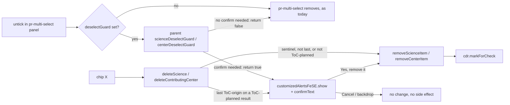

# Design — Confirm, don't block, removal of ToC-mapped contributors

## 1. Document Control

| Field | Value |
|---|---|
| Spec path | `changes/toc-sp-removal-confirm` |
| Requirements | [`requirements.md`](./requirements.md) |
| Depth | Standard (small) |
| Verified at | `c12bb4d29` (branch `qa-development-2026-ss`) |
| Skills | `angular-developer`, `tdd`; `spartan` not needed (no new UI primitive) |
| Design route | Existing pattern: reuse the `customizedAlertsFeSE` confirm dialog (as `onSyncSection` and `pr-multi-select.confirmDeletionEvent` do). No new visual surface, so Impeccable is not engaged |
| Review | Judgment Day ESCALATED after 2 rounds ([`judgment.md`](./judgment.md)). Revision 4 applies the fix both judges proposed for R-1/R2-1 (native checkbox write), by user decision 2026-11-27: **fixed, not re-judged** |

## 2. Executive Summary

Changes in four places:

- **`rd-contributors-and-partners`** component (ts/html)
  - The "block" helpers become "confirm" helpers that **defer** the removal to the dialog's confirm callback.
  - The removal bodies are extracted so the immediate and confirmed paths run the same code.
  - The callback calls `cdr.markForCheck()`, because the app is zoneless.
  - The lead recompute moves from the template into the handler.
  - The P2-3249 rule collapses to "≥1 real Center, any origin".
- **`rd-contributors-and-partners`** service: lead auto-assign ignores the "Other(s)" sentinel.
- **`pr-multi-select`**: an additive, opt-in `deselectGuard` input lets a parent intercept a panel deselect. When unset, the other ~80 instances behave exactly as before.
- Specs and the folder `CLAUDE.md` files.

## 3. Architecture Overview

## 4. Extended Directory Structure

| File | Change |
|---|---|
| `rd-contributors-and-partners/rd-contributors-and-partners.component.ts` | Confirm helpers, extracted removal methods, deselect guards, `markForCheck`, relaxed completeness, copy. Stale comments updated: the P2-3249 JSDoc (`:530-561`), the two-marker getter comment (`:591-597`), the `TOC-*` comments on the handlers |
| `rd-contributors-and-partners/rd-contributors-and-partners.component.html` | `:185` drops the second statement `this.rdPartnersSE.setPossibleLeadCenters(true)`; `[deselectGuard]` on the SP dropdown (`:475`) and on both `contributing_center` dropdowns (`:122`, `:149`); one Centers marker (the `@if (requiresTocCenter)` branch at `:251-263` collapses) |
| `rd-contributors-and-partners/rd-contributors-and-partners.service.ts` | `tryAutoAssignLeadCenter` ignores `OTHER_CENTERS_CODE` |
| `custom-fields/pr-multi-select/pr-multi-select.component.ts` | New input `deselectGuard`, consulted only in the deselect branch of `onSelectOption` |
| `custom-fields/pr-multi-select/pr-multi-select.cy.ts` (or `contract.cy.ts`) | CT: hook unset (unchanged) and hook set (intercepts) |
| `custom-fields/pr-multi-select/CLAUDE.md` | Document the input; re-stamp `Verified:` |
| `rd-contributors-and-partners/*.spec.ts`, `*.zoneless.spec.ts` | See §8 Tests |
| `rd-contributors-and-partners/CLAUDE.md` | Supersede `TOC-SP-DD-*`, `TOC-C-DD-*`, P2-3249, the P2-3738 `requiresTocCenter` paragraph and the "dos marcadores / congela labelText" entry; re-stamp `Verified:` |
| `result-detail/components/section-bottom-bar/section-bottom-bar.component.ts:209-210` | Comment: "markers" becomes singular |

## 5. Data Model

No change.

## 6. API Design

No change. The PATCH body keeps its shape. A confirmed removal sends one fewer item, as an ordinary removal does today.

## 7. Backend Module Design

n/a. Both server checks are already permissive or consistent (P-6).

## 8. Frontend / UX Component Architecture

| Element | Behavior |
|---|---|
| `deleteScience(index)` | Resolves `item = scienceSelected[index]`. If it is the sentinel or `!shouldConfirmLastScience()` → `removeScienceItem(item)`. Otherwise → `confirmRemoval('science', () => removeScienceItem(item))` |
| `deleteContributingCenter(index, updateComponent)` | Same shape with `removeCenterItem(item, updateComponent)` |
| `removeScienceItem(item)` | Returns early if `item` is no longer in `scienceSelected` (identity). Otherwise: filter by identity, the existing Other(s) cascade (`if (!showOtherScience) otherScienceSelected = []`), then `cdr.markForCheck()` |
| `removeCenterItem(item, updateComponent)` | Returns early if gone, **before any side effect**. Otherwise today's body (`updatingLeadData`, filter by identity, lead clear, Other cascade, `setTimeout` re-render), then `rdPartnersSE.setPossibleLeadCenters(true)` (moved from `html:185`), then `cdr.markForCheck()` |
| `confirmRemoval(kind, onConfirm)` | `customizedAlertsFeSE.show({ id, title, description, status: 'warning', confirmText: 'Yes, remove it' }, onConfirm)`. Ids: `toc-science-program-remove-confirm`, `toc-center-remove-confirm`. Copy per TRC-R-1/R-2 |
| `shouldConfirmLastScience()` / `shouldConfirmLastCenter()` | The old `blockIfLast*` conditions (`hasTocPlanned*` and `getReal*Count() - 1 <= 0`), returned as a boolean with no side effect |
| `scienceDeselectGuard` / `centerDeselectGuard` | Arrow-function properties (stable references) given `option`. If the option is the sentinel or no confirm is needed → `false` (pr-multi-select proceeds as today). Otherwise: find the model item with the same `id` / `code`, open `confirmRemoval(kind, () => removeXItem(match))`, and return `true` |
| `pr-multi-select.deselectGuard` | `input<((option: any) => boolean) \| null>(null)`. Consulted only when an **active** item is being removed: the deselect branch of `onSelectOption`, and not the `logicalDeletion` re-activation of an inactive item. If the guard returns `true`, the component does not change `value` and does not emit. It then **restores the visible tick by writing the native checkbox**: the checkbox paths (flat `.html:58`, group `.html:40`) pass their element (a `#cb` template ref) to `onSelectOption(option, cb?)`, and on intercept the component sets `option.selected = true` and `cb.checked = true`. **Amended 2026-11-27 (Pivot on TRC-T-6):** on intercept the component also sets the row's NgModel `viewModel` back to `true` (the checkbox paths expose `#m="ngModel"` and pass it as well). Without that, NgModel keeps the `false` from the user's click, and when the parent's confirmed removal later sets `option.selected = false`, NgModel sees no change and never unticks the box (P-10). The write runs only inside the veto branch, so instances without a guard never reach it. The label paths (`.html:42`, `.html:60`) pass no ref and need no write (R2-2). No clone rebuild, and no change to `cdkVirtualForTemplateCacheSize` (P-10). "Select all / Unselect all" (`.ts:227-247`) does not consult the guard; it is not enabled on the wired dropdowns, and the input docs say so |
| `deleteOtherScience` / `deleteOtherCenter` | Unchanged (never guarded). The "Other(s)" dropdowns get no `deselectGuard` |
| `tryAutoAssignLeadCenter` | Builds the union without `OTHER_CENTERS_CODE` before the "exactly one" check. Accepted widening (P-12): `[C1, sentinel]` with no Other centers and no valid lead now auto-assigns C1, the same as `[C1]` alone |
| Completeness | `contributingCentersComplete` = toc + other real Centers > 0, always. `contributingCentersValidationMessage` = `contributingCentersEmptyNote`, always. `requiresTocCenter` and `contributingCentersRequiredNote` are removed |
| Marker | One `appFeedbackValidation` marker with the static label "Contributing CGIAR Centers" and `[isComplete]="contributingCentersComplete"`. `cp-centers-mandatory-marker` keeps its testid |
| Asterisks | Unchanged by decision (`html:129` ToC dropdown required; `:213` Other(s) required only without ToC refs). Visual only; the pinning test `zoneless.spec.ts:654-662` stays |

### Tests

| Suite | Change |
|---|---|
| `component.spec.ts` guard describes (`:328,388` SP; `:467,526,582` Centers) | Assert the confirm dialog: config with `confirmText`, the arrays unchanged before the callback, the callback removes, not calling it keeps. Exemptions are tested per TRC-S-1.3 / 2.3 |
| `component.spec.ts` P2-3249 block (`:1664-1779`) | `requiresTocCenter` assertions are removed; `contributingCentersComplete` with only Other(s) under ToC refs → `true`; the message never mentions ToC or Other(s) |
| `zoneless.spec.ts` P2-3249 describe (`:432-734`) | `TOC_LABEL` (`:444`) is removed, and its uses at `:572`, `:582`, `:596` move to `PLAIN_LABEL`. `:573` (`validationNoteText` contains "Theory of Change") flips to not-contains. `:587` ("keeps listing when replaced by Other(s)") flips to "drops the field". `:601-619` (sentinel plus one Other center → `'todo'`) flips to `'ok'`; a new case covers the sentinel with **no** Other center → `'todo'` |
| `zoneless.spec.ts` new describe | Setup: append an `<app-root>` to `document.body` (the real service inserts into it, `customized-alerts-fe.service.ts:37-38`) and remove `.custom_modal_container` nodes after each test. The real `CustomizedAlertsFeService`. Click the SP chip X, then `#confirm-toc-science-program-remove-confirm`, then `await fixture.whenStable()` with **no** `detectChanges` → the chip is gone. **Red run:** the same case without `markForCheck` must fail. The SP case is the only one that proves DD-7: the Center callback also writes the `updatingLeadData` signal, which repaints by itself. The Center case still asserts the removal and the lead. Cancel → the chips are intact and `leadCenterCode` is unchanged |
| `zoneless.spec.ts:142` (`deleteContributingCenter(0, true)`) | Still valid. Re-verify it still reaches the lead select re-show |
| `service.spec.ts` (auto-assign) | New cases: `[sentinel]` with no Other centers → the lead is **not** the sentinel; `[C1, sentinel]` with no Other centers and a null lead → the lead is C1 (accepted widening, P-12) |
| `pr-multi-select` CT | Hook unset: an untick removes and emits (unchanged). Hook returns `true`, for the checkbox click and the label click, in **flat and group** mode: `value` unchanged, no emit, and the DOM `input.checked` property is `true` (assert the DOM, never `option.selected`). Hook returns `false`: removes as today. `logicalDeletion` re-activating an inactive item does not call the hook. **Amended 2026-11-27 (Pivot on TRC-T-6):** hook returns `true`, then the host removes the item from `value` (the model-side removal a confirmed Yes performs), in **flat and group** mode: DOM `input.checked` becomes `false` with no further user click |
| `zoneless.spec.ts` panel-untick describe (TRC-T-4) | **Amended 2026-11-27 (Pivot on TRC-T-6):** the "Yes removes the chip and the option" cases assert the DOM `input.checked === false` of the option's checkbox, not only `option.selected` |

## 9. Shared Contracts or Package Extensions

`pr-multi-select` gains one opt-in input, `deselectGuard`. Default `null` means no behavior change for the existing instances (P-9).

## 10. Design Decisions

| ID | Decision | Rationale / rejected alternative | Covers |
|---|---|---|---|
| TRC-DD-1 | Replace `blockIfLast*` with side-effect-free `shouldConfirmLast*()` plus a shared `confirmRemoval(kind, onConfirm)` | Reuses the shipped trigger conditions. Rejected: confirming every ToC chip (not asked for) | R-1, R-2 |
| TRC-DD-2 | Extract `removeScienceItem` / `removeCenterItem`, called by every path (immediate, confirmed, panel-confirmed) | One code path, so a confirmed removal equals an ordinary one | S-1.1, S-2.1 |
| TRC-DD-3 | Remove by identity; return early before any side effect if the item is gone | Index is stale-prone across an async boundary; the dialog lives on `app-root` and can outlive the route (JD-11) | R-1, R-2 |
| TRC-DD-4 | Move `setPossibleLeadCenters(true)` from `html:185` into `removeCenterItem` | Opening the dialog must have no side effect (TRC-S-2.2, JD-2). The immediate path still recomputes, as today | S-2.1, S-2.2 |
| TRC-DD-5 | Collapse P2-3249: remove `requiresTocCenter`, `contributingCentersRequiredNote` and the ToC marker branch | Product override (Santiago, 2026-11-27). A dead getter would invite re-wiring | R-3 |
| TRC-DD-6 | Static, generic copy; no `TermKey` | Same precedent as the sibling notes; no escaping surface | NFR-3 |
| TRC-DD-7 | `cdr.markForCheck()` at the end of each `remove*Item` | The app is zoneless (P-3); a native-listener callback schedules nothing. Rejected: `ViewRefreshService.schedule()` (global refresh; the local `markForCheck` is enough and `cdr` is already injected, `component.ts:359`) | S-1.1 "disappear" |
| TRC-DD-8 | `tryAutoAssignLeadCenter` excludes the sentinel | After a confirmed last-ToC removal with no Other centers, the union is `[sentinel]` and would auto-assign `'__OTHER_CENTERS__'` (JD-8). Scoped to auto-assign only; `getContributingCentersUnion` keeps its other callers' semantics. Accepted side effect: `[C1, sentinel]` auto-assigns C1, consistent with `[C1]` (P-12) | S-2.1 |
| TRC-DD-9 | An opt-in `deselectGuard` input on `pr-multi-select`, wired only on the ToC-origin SP and `contributing_center` dropdowns. Called only when an active item is being removed; on intercept the visible tick is restored by writing the native checkbox (`cb.checked = true`), and the row's NgModel `viewModel` is reset to `true` so that a later confirmed removal unticks it (amended 2026-11-27, Pivot on TRC-T-6). Rejected for that amendment: re-syncing every rendered checkbox on each `value` change (it runs for all ~80 instances); writing the box from the parent's callback (it leaks pr-multi-select DOM); `viewToModelUpdate` (it emits `ngModelChange` and re-enters `onSelectOption`) | User decision (JD-9: confirm in the panel too). Rejected: reusing `confirmDeletion` (it applies to the component's own chip X for `new` items, with fixed Initiative copy). Rejected: re-deriving the flag, rebuilding the clones, or `syncSelectionFlags()` (none re-ticks the DOM; CDK recycles views, P-10). Rejected: `cdkVirtualForTemplateCacheSize = 0` (affects ~80 instances; not group mode) | S-1.4, S-2.4 |

### Reversion challenge (Step 2.3): "what does removing this break?"

| Reverted behavior | What it could break | Finding |
|---|---|---|
| The ToC Science Program / Center floor (TOC-SP-DD-1, TOC-C-DD-1) | A result could be saved with 0 ToC contributors | Intended. No server or client completeness rule depends on it (P-5, P-6). The pinning tests are rewritten |
| P2-3249 ToC-only Centers rule | (a) PO intent; (b) the pinning tests; (c) the card colour | (a) Explicit override, recorded here and in `CLAUDE.md`. (b) Enumerated in P-7 and §8 Tests, including the two zoneless cases whose intent flips. (c) The card reads the same getter (`html:130`). The **sentinel only, no Other center** case still reads incomplete |
| The template-level `setPossibleLeadCenters(true)` at `html:185` | Lead options or the lead re-render after an immediate delete | Moved into `removeCenterItem`, so the immediate path keeps the same order (delete, then recompute) |

## 11. Premise Ledger

Count: 12 verified · 0 UNVERIFIED (P-3 corrected after Judgment Day round 1; P-10 corrected and P-12 added after round 2).
Blast-radius triggers fired: `live-path` (user click and panel untick), `shared-state` (`contributingCentersComplete` readers; `pr-multi-select` shared across ~80 instances; `tryAutoAssignLeadCenter` callers), `consumer` (test ids, labels, alert ids, the new input).

| # | Claim | Class | Citation (as run) | Verified at | If false | Settled by |
|---|---|---|---|---|---|---|
| P-1 | The SP chip X calls `deleteScience(i)`; the Center chip X calls `deleteContributingCenter(i); rdPartnersSE.setPossibleLeadCenters(true)`; no template passes `updateComponent` (only specs, `component.spec.ts:213`, `zoneless.spec.ts:146`). The class is only routed (`rd-contributors-and-partners-routing.module.ts:13`) | live-path | Grep `deleteScience\(\|deleteContributingCenter\(` over `src/app/**/*.html` → `component.html:489`, `:185` | c12bb4d29 | DD-1/DD-4 target the wrong handler (High) | — |
| P-2 | The confirm dialog runs the callback only on Confirm; Cancel and the backdrop only close | existence | `customized-alerts-fe.service.ts:69-81` | c12bb4d29 | S-1.2/S-2.2 fail (High) | — |
| P-3 | The app bootstraps **zoneless**: a native `addEventListener` callback that writes plain fields schedules no change detection | data-env | `shared/services/view-refresh.service.ts:6-7`; grep `provideZoneChangeDetection` in `app.module.ts` / `main.ts` → 0 hits; `component.ts:966-968` (zoneless comment); `scienceSelected` is a plain field (`service.ts:123`) | c12bb4d29 | Without DD-7 the chip stays visible (High); the zoneless test in §8 locks it | — |
| P-4 | Other `deleteContributingCenter` methods (IPSR `ipsr-contributors.component.ts:190`, AOW `aow-hlo-create-modal.component.ts:381`, `rd-partners.component.ts:138`) are separate and untouched | shared-state | Same grep as P-1: `ipsr-contributors.component.html:120`, `aow-hlo-create-modal.component.html:270`, `rd-partners.component.html:29` | c12bb4d29 | Scope grows (Low) | — |
| P-5 | No client completeness marker counts Science Programs; the SP dropdown is `[required]="false"` | existence | Grep `(?i)appFeedbackValidation[^>]*(science\|Program)\|scienceComplete\|requiresTocScience` in the folder → 0 hits; `component.html:481` | c12bb4d29 | A removed SP would add a "field missing" (Low) | — |
| P-6 | Server checks: the P25 green check counts neither initiatives nor centers; the other check requires ≥1 `results_center` of any origin (consistent with TRC-R-3) | existence | `1792100000000-TKG-TocKpiOptionalGreenCheck.ts:117-181`; `results-validation-module.repository.ts:438-448` | c12bb4d29 | Users could not submit after a removal (High) | — |
| P-7 | Readers of the P2-3249 rule, copy, marker and the old alert ids | consumer | Grep `at least one from the ToC\|contributingCentersComplete\|requiresTocCenter\|cp-centers-validation\|cp-centers-mandatory-marker\|contributingCentersValidationMessage\|toc-center-min\|toc-science-program-min` over `onecgiar-pr-client` (excluding node_modules) → `component.html:130,245,251,256,262`; `component.ts`; `component.spec.ts:328,388,467,526,582,1664-1779`; `zoneless.spec.ts:444-640,719,863`; `section-bottom-bar.component.ts:210` (comment); folder `CLAUDE.md`; 0 Cypress hits. Outside the client: `docs/context-ai/fase-vs-portafolio.md` mentions P2-3249 (historical context, left as is) | c12bb4d29 | Stale tests or a reader keeps the old rule (High) | — |
| P-8 | `setPossibleLeadCenters(true)` rebuilds the lead options from the full catalog and calls `tryAutoAssignLeadCenter()`, which sets `leadCenterCode` when the union has exactly 1 entry and the lead is invalid | other | `service.ts:723-745`, `:1012-1021` | c12bb4d29 | DD-4/DD-8 reasoning wrong (Low); T-2 asserts the lead after Confirm and Cancel | — |
| P-9 | `pr-multi-select` has no existing deselect hook; its deselect branch mutates `value` then emits | existence / shared-state | `pr-multi-select.component.ts:466-500`; inputs are signal `input()` (`:26`, `:48-49`). With `deselectGuard` defaulting to `null`, the ~80 instances keep today's path | c12bb4d29 | The new input changes other screens (High); the CT case "hook unset" locks it | — |
| P-10 | (Corrected after Judgment Day round 2, by both judges.) After an intercepted untick, no model-side change re-ticks the DOM box. The `[ngModel]` binding's stored value stays `true`, so NgModel never writes back. Rebuilding the clones does not help either: `cdkVirtualFor` recycles row views (`_RecycleViewRepeaterStrategy`, cache 20; only `context.$implicit` is swapped), and the same holds for `syncSelectionFlags()` in group mode. Only a direct write to the native `checked` property restores it. ~~NgModel stays consistent: its next real change (`true`→`false`) still differs from the stored `true`~~ **Corrected 2026-11-27 (TRC-T-6, measured in the live DOM):** NgModel compares each new value with its own `viewModel`, which the user's untick already set to `false`. So a later model-side `false` (the confirmed removal) is not a change, and the box stays ticked. The veto must also reset the row's NgModel `viewModel` to `true`. A second *user* untick still works either way, which is why the round-2 CT case passed | other | `pr-multi-select.component.html:40,55-58`; `node_modules/@angular/cdk/fesm2022/scrolling.mjs:987`; `_recycle-view-repeater-strategy-chunk.mjs:25,57-62,66-68,89` (as re-run by both judges) | c12bb4d29 | Cancel leaves the box visually unticked (High for S-1.4/S-2.4). The CT asserts DOM `input.checked` in flat and group mode | — |
| P-12 | `tryAutoAssignLeadCenter` is reached by W1/W2 (`setPossibleLeadCenters`, `service.ts:736-738`; `onLeadCenterSelected(null)` → `:843`) and by IPSR (`runAutoAssignLeads`, the same service; `ipsr-contributors.component.spec.ts:1235-1242`). Excluding the sentinel only changes states where the sentinel inflated the union | shared-state | `service.ts:736-738`, `:843`, `:1007-1022`; `service.spec.ts:464-519`, `:686-698` (they do not pin this state) | c12bb4d29 | IPSR or W1/W2 lead behavior changes unexpectedly (Low; IPSR never puts the W1/W2 sentinel in its union); covered by the new service cases | — |
| P-11 | The prefill effects do not re-add a manually removed item (same ToC signature; hydration guard after save) | shared-state | `component.ts:630,633,810,813`; `service.ts:251-252,608` | c12bb4d29 | The removed item comes back (High) | — |

## 12. Budget (Step 2.4)

| Metric | Estimate |
|---|---|
| Tasks | 6 (5 code + 1 manual browser check) |
| LOC | ~110 production, ~270 test (≈380 total) |
| Review rounds | 1 per task (code, not rules text); T-3 (shared custom field) budgets 2 → 6 total |
