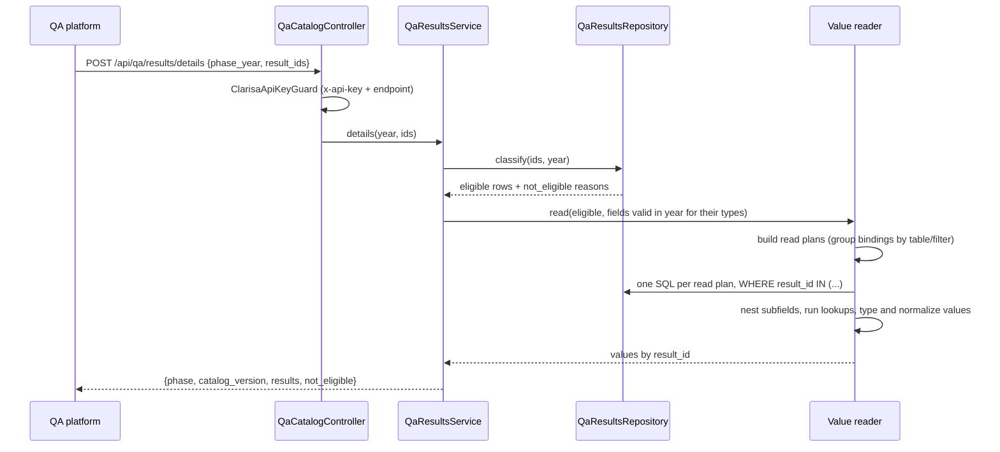

# Design — QA results feed (`quality-assurance/qa-results-feed`)

## Document Control

| Field | Value |
|---|---|
| Spec | `docs/specs/quality-assurance/qa-results-feed/` |
| Depth | Full |
| Requirements | `requirements.md` (QRF-R-1..10, approved 2026-10-28, amended at Phase 2) |
| Ticket | [P2-4037](https://cgiarmel.atlassian.net/browse/P2-4037) |
| Status | approved 2026-10-28 (Juan David — "Continue", Review Design not run) |
| Verified at | `72fad2b88` |
| Exploration | inline (targeted greps; no scout spawned) |

## 1. Summary

Two routes are added to the existing `QaCatalogController`. One **eligibility query** serves both routes. A **binding-driven value reader** turns each catalog field's `storage` binding into a value, batching all results of a request per read plan. The catalog stays the only definition of what QA can see: the reader is driven by `CATALOG_FIELDS` and projects by key. No table, migration or new module is added.

## 1A. Premise Ledger

Verified 15 · UNVERIFIED 4 (High 2: P-2, P-12 · Low 2: P-7, P-14).
Blast-radius triggers: `consumer` fires (the JWT-exclude list in `app.module.ts` and the `/api/qa/*` response family change); `shared-state` fires (`JwtMiddleware` exclusions and the global throttler read the same path set); `live-path` does not apply — no user action, the entry point is the route itself.

| # | Claim | Class | Citation (as run) | Verified at | If false | Settled by |
|---|---|---|---|---|---|---|
| P-1 | `ClarisaApiKeyGuard` reads the route's `@BilateralClarisaEndpoint` string and validates key + endpoint with CLARISA; missing metadata → 401 | location | `src/api/bilateral/guards/clarisa-api-key.guard.ts:29-45`; `decorators/bilateral-clarisa-endpoint.decorator.ts:3-6` | 72fad2b88 | DD-1 auth reuse changes — **High** | — |
| P-2 | CLARISA grants permission per endpoint string, so the QA client must be granted `/api/qa/results` and `/api/qa/results/details` | data-env | `UNVERIFIED — confirm at source before relying on it` (only secondary: `docs/qa-catalog.en.md` known gap 5, "CLARISA test key with permission `/api/qa/catalog`") | — | A rollout step (grant) disappears or becomes blocking — **High** | T-8 live call with the QA test key, owner Juan David / CLARISA owner |
| P-3 | The JWT middleware excludes exact paths; `/api/qa/catalog` is listed one by one, so new routes need their own entries | location | `src/app.module.ts:146-155` | 72fad2b88 | T-1 scope changes — Low | — |
| P-4 | `ResponseInterceptor` is per-controller (no global registration) and `QaCatalogController` does not use it | existence | `grep -rn "useGlobalInterceptors\|APP_INTERCEPTOR" src/main.ts src/app.module.ts` → 0 hits; `qa-catalog.controller.ts:22-30` | 72fad2b88 | Envelope stripping needs work — Low | — |
| P-5 | The global throttler already skips every `/api/qa/` path | location | `src/shared/guards/throttler-exclude-bilateral.guard.ts:9` (`['/api/bilateral', '/api/qa/']`) | 72fad2b88 | Need a throttler change — Low | — |
| P-6 | W1/W2 ⇔ `source = 'Result'`: bilateral writers set `SourceEnum.Bilateral` (`'API'`); the SGP-02 UI path sets it too; `createOwnerResult` writes `source` only when truthy, else the column default `'Result'` applies | data-env | `src/api/results/results.service.ts:3354-3357, 630-631`; `src/api/bilateral-ai/services/bilateral-ai.service.ts:1344`; `results.service.ts:3980, 3987, 4349`; `result.entity.ts:505-513` | 72fad2b88 | Eligibility predicate changes (DD-3) — **High** | — |
| P-7 | No Submitted row has `source IS NULL` in prod (the column is nullable) | data-env | `UNVERIFIED — confirm at source before relying on it` | — | Predicate must accept NULL as W1/W2 — Low (one clause) | T-8 SQL count `GROUP BY source`, owner Juan David |
| P-8 | Submit writes a `submission` row `status=true, status_id=3`; unsubmit writes `status=false, status_id=1` | location | `src/api/results/submissions/submissions.service.ts:152-153, 218-219, 275, 350-351` | 72fad2b88 | `submitted_at` source (DD-5) changes — Low | — |
| P-9 | Lead program = `results_by_inititiative.initiative_role_id = 1`, active; same stored value as catalog field `general.primary_program` | location | `src/api/results/result.repository.ts:372, 468, 525`; `docs/qa-catalog.en.md` "Stored values" (`general.primary_program`) | 72fad2b88 | DD-4 changes — Low | — |
| P-10 | The catalog has no `result_type_id` ↔ key mapping | existence | `grep -rn "result_type_id\|ResultTypeEnum\|type_id" src/api/qa-catalog/definitions/*.ts src/api/qa-catalog/*.ts` → only a comment in `closed-control-lists.ts:28` and two unrelated column names | 72fad2b88 | DD-2 (new map) is unnecessary — Low | — |
| P-11 | Result types 3 and 11 have no catalog key; 10 is `innovation_package` | existence | `src/api/qa-catalog/definitions/result-types.ts` (9 keys) vs `src/shared/constants/result-type.enum.ts` (11 ids) | 72fad2b88 | `type_not_catalogued` reason unnecessary — Low | — |
| P-12 | A `phase_year` covers both Reporting (`app_module_id=1`) and IPSR (`=2`) versions, and type-10 results live in IPSR versions | data-env | `src/shared/constants/role-type.enum.ts:26-29`; `version.entity.ts:57, 79`; type-10 placement `UNVERIFIED — confirm at source before relying on it` | — | DD-3 phase predicate changes (OQ-4) — **High** | HITL at T-8 (owner answers OQ-4 with a SQL count per app module) |
| P-13 | Lookup sources are logical names: `toc.integration_information.<t>` → `${DB_TOC}.<t>`; `clarisa.institutions` → `clarisa_institutions`; `prms.<t>` → `<t>` | location | `grep -rho "source: '[a-z_.]*'" src/api/qa-catalog/definitions/sections \| sort \| uniq -c` → 7 distinct sources; `src/toc/toc-results/toc-results.repository.ts:1034-1035` (`${env.DB_TOC}`); `clarisa-institution.entity.ts:15`; `result-question.entity.ts:13`, `fair-fields.entity.ts:13`, `investment-discontinued-option.entity.ts:13` | 72fad2b88 | DD-8 source registry changes — Low | — |
| P-14 | Every table a `relation` or `path` binding reads as an element has a single-column primary key (needed to attach subfields to their element) | data-env | `UNVERIFIED — confirm at source before relying on it` | — | DD-7 element identity needs composite keys — Low | T-3 first step: metadata test over the bound tables, owner T-3 |
| P-15 | `capacity_sharing.length_of_training` / `degree` bind the raw `capdev_term_id`, and the catalog assigns their normalization to this endpoint | other | `src/api/qa-catalog/definitions/sections/capacity-sharing.ts:68-75`; `docs/qa-catalog.en.md` known gap 17 | 72fad2b88 | DD-10 normalization task disappears — Low | — |
| P-16 | `catalog_version` = `${year}.${CATALOG_VERSIONS[year].revision}`, read from code, no DB | location | `src/api/qa-catalog/qa-catalog.service.ts:38-45, 77`; `definitions/versions.ts` | 72fad2b88 | DD-9 changes — Low | — |
| P-17 | 2026 bindings: 86 `column`, 52 `relation`, 31 `path`, 12 `lookup` | data-env | `grep -rho "kind: '[a-z]*'" src/api/qa-catalog/definitions/sections \| sort \| uniq -c` | 72fad2b88 | Budget / read-plan count changes — Low | — |
| P-18 (consumer) | Readers of the JWT-exclude list and the `/api/qa/*` path set | consumer | `grep -rln "api/qa/catalog" onecgiar-pr-server` (whole package, excl. `node_modules`) → `docs/qa-catalog.en.md`, `src/app.module.ts`, `src/app.module.spec.ts:52` (pins the exact exclude list), `src/shared/guards/throttler-exclude-bilateral.guard.spec.ts:23`, `qa-catalog.controller.ts`, `qa-catalog.module.spec.ts`, `qa-catalog.controller.spec.ts`. External: QA platform (P2-3905) | 72fad2b88 | T-1 misses a pinned list — Low | — |
| P-19 (shared-state) | Readers of the excluded-path set: `JwtMiddleware` exclusion (`app.module.ts:146-155`) and the throttler prefix list (`throttler-exclude-bilateral.guard.ts:9`); no other reader | shared-state | `grep -rn "'/api/qa\|api/qa/" onecgiar-pr-server/src` → the two sites above plus specs and the controller | 72fad2b88 | T-1 scope — Low | — |

All paths above are relative to `onecgiar-pr-server/` unless they start with `docs/`.

## 2. Architecture Overview

### 2.1 Where this lives

| Piece | Location | Role |
|---|---|---|
| Controller methods | `api/qa-catalog/qa-catalog.controller.ts` | `GET results`, `POST results/details` — same guard, no envelope |
| DTOs | `api/qa-catalog/dto/qa-results-*.dto.ts` | Query/body validation and response types |
| `QaResultsService` | `api/qa-catalog/qa-results.service.ts` | Eligibility, paging, batch partition, projection |
| `QaResultsRepository` | `api/qa-catalog/qa-results.repository.ts` | Eligibility + breakdown SQL (raw, parameterized) |
| Value reader | `api/qa-catalog/values/` | Read-plan builder, one resolver per binding kind, typing, normalizers |
| Type-key map | `api/qa-catalog/definitions/result-type-ids.ts` | `result_type_id` ↔ catalog key (internal, not projected) |

### 2.2 Interaction

## 3. Data Model Changes

None. No entity, no migration, no catalog content change (the catalog snapshot and `catalog_version` are untouched).

## 4. API Surface

| Route | Input | 200 body | Errors |
|---|---|---|---|
| `GET /api/qa/results` | `phase_year` (req.), `program_ids`, `result_type_keys` (CSV), `page`, `page_size` | `{ phase, page, page_size, total, breakdown: { by_program: [{clarisa_id, code, count}], by_result_type: [{key, count}] }, items: [...] }` | 400 / 401 / 404 |
| `POST /api/qa/results/details` | `{ phase_year, result_ids[], field_keys?[] }` | `{ phase, catalog_version, results: [{result_id, result_code, result_type_key, values}], not_eligible: [{result_id, reason}] }` | 400 / 401 / 404 |

Limits (OQ-5, confirmed 2026-10-28; constants in one file): `page_size` default 100, max 200; batch max 50.
Endpoint strings for the guard: `/api/qa/results` and `/api/qa/results/details`.
Contract doc: `onecgiar-pr-server/docs/qa-catalog.en.md` gains a "Results feed" part and a change-log row (QRF-R-10).

## 5. Server Workflow / Business Rules

1. **Validate** (`ValidationPipe`, whitelist + transform like the catalog route). Unknown `result_type_keys` are checked against the keys of the year's catalog → 400 naming them. Year without catalog → 404 (same check as `getCatalog`).
2. **Eligibility** (DD-3..DD-5) — one parameterized SQL, used three ways: page, count, breakdown (list) and classify (details).
3. **Classify** (details): fetch the requested ids with all eligibility columns, without the eligibility predicate, and assign the first failing reason in the order `not_found`, `not_submitted`, `other_phase`, `not_w1w2`, `type_not_catalogued`, `no_lead_program`.
4. **Field selection**: the fields with `isValidIn(field, year)` whose `result_types` include the result's key or `*`.
5. **Read** (DD-6..DD-8): build read plans, run them, assemble per result.
6. **Project** (DD-9): output keys only from the catalog; missing → `null` / `[]`.
7. **Log** (QRF NFR): route, year, counts, duration. No ids, no values, no key.

## 6. Frontend Plan

n/a — no client change.

## 7. Security & Authorization

- `ClarisaApiKeyGuard` + `@BilateralClarisaEndpoint` on each method (P-1). The QA client needs both endpoint grants in CLARISA (P-2).
- All SQL parameterized. Table and column names come only from catalog bindings (code) and the source registry, never from input.
- Errors never carry SQL, table or column names (QRF-R-9). A failing read plan → 500 with a generic message; the log names the plan's field keys, not the SQL.

## 8. Performance & Capacity

- Statements per details call = 1 (classify) + read plans touched by the batch's types (≤ ~110 for 2026, independent of batch size) + lookup rounds.
- Read plans for one batch run with bounded concurrency (4) on the shared pool, so a batch cannot exhaust connections.
- List: one page query + one count + one breakdown query.
- Targets in `requirements.md` §6 are measured at T-8 on prtest.

## 9. Observability

One log line per call (route, `phase_year`, item/eligible/not-eligible counts, statement count, ms). On failure: field keys of the failing plan. Never key, ids, values, SQL.

## 10. Testing Plan

| Layer | What | Where |
|---|---|---|
| DTO | 400 cases (year, CSV, page bounds, batch size, non-integers) | `dto/*.spec.ts` |
| Repository | Predicates and ORDER BY present in the built SQL; parameters bound, never interpolated | `qa-results.repository.spec.ts` |
| Resolvers | One spec per binding kind on fixture rows where the correct and mutated readings differ (filter, NULL value row, pick order, join pairs, year match, alternative keys) | `values/*.spec.ts` |
| Service | Partition per reason; field selection per type and year; null/[] fill; whitelist walk at every depth; capdev normalization; statement count batch 1 vs 50 | `qa-results.service.spec.ts` |
| Controller | Guard + endpoint metadata on both methods, no interceptor, missing year → 400 | `qa-catalog.controller.spec.ts` |
| App wiring | Exclude list pins both new paths | `app.module.spec.ts` |
| Live (HITL) | Total vs SQL count, full paging pass, golden comparison ≥ 2 results/type, timing, CLARISA grants | T-8 |

## 11. Backwards Compatibility & Rollout

- Additive: `/api/qa/catalog` unchanged, no schema change (ADR-004).
- Rollout: deploy (automatic on merge) → CLARISA grants for the QA client (P-2) → QA starts calling. Rollback = revert; nothing persisted.

## 12. Design Decisions

| ID | Decision | Rejected | Why | Req |
|---|---|---|---|---|
| QRF-DD-1 | Routes live in `QaCatalogController` / `QaCatalogModule`; repository and reader are new providers there | New module | Same guard re-provision (catalog DD-6), same path prefix, one contract doc | R-1 |
| QRF-DD-2 | A separate internal map `result_type_id → key` in `definitions/result-type-ids.ts`, checked by a test against `CATALOG_RESULT_TYPES` and `ResultTypeEnum` | Add the id to `CatalogResultType` | Adding a property to catalog types would enter the content hash and force a `catalog_version` bump for no contract change (catalog DD-12) | R-3, R-5 |
| QRF-DD-3 | Eligibility = `is_active` ∧ `status_id=3` ∧ `source='Result'` ∧ `version.phase_year = :year` (both app modules, pending OQ-4) ∧ mapped type ∧ active lead | Reporting module only | `innovation_package` is a catalog type and lives in IPSR (P-12, UNVERIFIED) | R-3 |
| QRF-DD-4 | Program = lead initiative only (P-9); no lead → not eligible (`no_lead_program`) | Return `program: null` | QA scopes timelines by program; an unscoped result cannot be placed (P2-3905 AC 6) | R-3, R-4, R-8 |
| QRF-DD-5 | `submitted_at` = `MAX(created_date)` of active `submission` rows with `status = true` for the result (P-8), returned as UTC ISO | `result.last_updated_date` | Updated by any edit; submission rows are the submit history | R-5 |
| QRF-DD-6 | **Read plans:** bindings are grouped by (table, filter, element kind): all `column` bindings on `result` or on one per-type table become one SELECT; each `relation`/`path` with the same table, filter and join chain becomes one SELECT returning the element PK, the value column and every subfield `column`. Every SELECT is `WHERE <fk> IN (:resultIds)` | One query per field; reuse form services | Statement count independent of batch size; form services are per-result and JWT-scoped | R-7, NFR |
| QRF-DD-7 | **Element identity:** a list element is the row of its relation/path table, keyed by that table's PK (P-14); a subfield `path` starts from that row (catalog DD-12); a relation row whose `value_column` is NULL is not an element (catalog DD-13) | Positional elements | Subfields must attach to the right element | R-7 |
| QRF-DD-8 | **Lookups after base values:** a lookup reads its `from` keys from already-resolved values (sibling first, else top-level), collects distinct keys across the batch, and runs one SELECT per lookup source with alternatives as `OR`, qualifiers (`PHASE_YEAR` → the request year; `match:'year'` per the repository's canonical read), and `pick` as first row by order. Logical sources resolve through a fixed registry (P-13) | Join lookups into base queries | Keys may come from subfields; registry keeps physical names in one place | R-7 |
| QRF-DD-9 | **Typing and projection** by field `type`, as in `requirements.md` QRF-R-7; MySQL tinyint → boolean, DECIMAL strings → number, DATETIME → ISO UTC, `date` columns → `YYYY-MM-DD`. Projection builds objects key by key from the catalog (no spread), so nothing outside the catalog can appear. A scalar field with subfields projects as `{ value, <subfield key>: … }` (R-7 as amended 2026-10-28); its subfields are planned like list subfields, read from the same row/element | Return driver output | Whitelist by construction (QAC-R-12); stable types for QA | R-7, R-9 |
| QRF-DD-10 | **Normalizers** are a closed, keyed list applied after typing; the only entry is `capacity_sharing.length_of_training` (gap 17: raw 1/2 → length 4 + degree 1/2; raw 3/4 → that length, `degree` null) | Leave raw | The catalog assigns it to this endpoint (P-15) | R-7 |
| QRF-DD-11 | Field selection: `details` takes optional `field_keys` (top-level keys only — QA's unit of selection, QAC-R-14); read plans are built only for the selected fields, so an unrequested field is never read. Personal data is not filtered otherwise; the contract doc lists the person-bearing keys so the QA Admin chooses knowingly (OQ-8 resolved 2026-10-28) | Filter personal fields in the feed; always return everything | Keeps one source of truth for "what QA sees" | R-9 |
| QRF-DD-12 | Limits are constants (`page_size` 100/200, batch 50), changed by code only | Env config | Contract values; QA must know them (documented) | R-5, R-7 |

**Reversion challenge (Step 2.3):** n/a — no decision removes, disables or inverts delivered behavior.

## 13. Budget (Step 2.4)

| Metric | Estimate |
|---|---|
| Tasks | 8 |
| LOC | ~1 600 (≈ 650 production, ≈ 950 tests/fixtures/doc) — **re-baselined 2026-10-28 to ~4 500** (Juan David, at the budget tripwire after T-3: actual ~2 350 after 2 tasks; falsifier specs with fixtures dominate), **then to ~6 200** (Juan David, at the tripwire after T-5: actual ~4 640 after 5 tasks; T-6 projected 900–1 300, T-7 ~200) |
| Review rounds | 12 (resolver tasks T-4/T-5 estimated at 2 each) |

Depth check: Full holds (external contract + generic reader over 181 bindings).

## 14. Open Gaps & Follow-ups

- OQ-4 (P-12) and P-2 grants are settled at T-8; OQ-5 limits confirmed, timing measured there.
- Q1 resolved (both ids; `details` takes `result_id`). Q2 decided → separate spec (unsubmit lock by QA round). OQ-8 resolved (QA requests fields via `field_keys`). Q3 stays open; it does not block implementation.
- TRD §7 Integration Points: record the QA row as a **pending** item (shared-file discipline; applied on `staging`).
